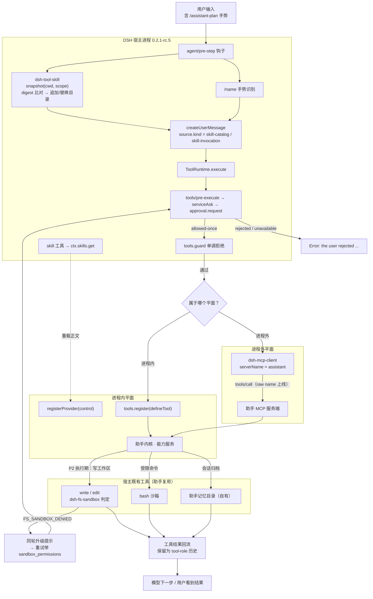

# Skill 插件深度集成 · 网络对象处理 · 破甲方法论辨析

本文回答三件事，对应三部分：

1. **桌面 AI 助手（五模块）如何与 DSH 宿主的 Skill 插件体系深度集成** —— 含技术架构、接口规范、数据格式、通信协议、调用链路、权限控制、异常处理、可扩展性、向后兼容、技术选型、实现步骤、测试策略、部署文档。
2. **公网 IP / 域名解析 / 私网 IP 三类对象的处理规格** —— 每类给输入格式、处理逻辑、输出内容、失败面。
3. **「破甲方法论」到底有多少可吸收** —— 逐条拆解，说清哪些真有用、哪些是换个说法的常识、哪些不能吸收。

> 对照实现：DeepSeek Harness **0.2.1-rc.5**（本机 `D:\pppp\deepseek\resources\app.asar`）。
> 全文标注 **〔代码确证〕**（附 `包:行号`，可复核）、**〔实测〕**（本机跑出来的数）、**〔据 RFC〕**（标准条文）、**〔设计〕**（本文的取舍建议）。
> 宿主全程只读，未安装、未启用任何插件，未改动宿主字段。

---

## 0. 三张结论表（先看这里）

### 0.1 集成：两条平面，不是一套

| 需求 | 进程内（Cordis 插件） | 进程外（MCP） |
|---|---|---|
| 出现在 `<available_skills>` 目录 | 可以（`ctx.skills.register` / `registerProvider`） | **无通道** |
| 贡献 system prompt 段 | 可以（`ctx.systemPrompt.section()`） | 仅 `mcp:<serverName>` 一段字面文本，且 ≤ 32 KiB |
| 按 agent / preset 分层可见 | 可以（scope 分层） | **不行**，绑死在 plugin 行上 |
| 细粒度拒绝（读参数再判） | 可以（`ctx.tools.guard`） | **不行**，只能整体不可用 |
| 用户 `/name` 显式调用 | 可以（`userInvocable`） | **不支持** |
| 宿主沙箱覆盖 | **覆盖**（`dsh-fs-sandbox` 判定） | **不覆盖**（宿主只看见一次 MCP 调用） |
| 崩溃不连累宿主 / 跨语言 | 不行 | 可以 |

**一句话**：进程内买**深度**，进程外买**隔离**。助手内核主体走进程内，把「不可信 / 重活」（样本解析、评测跑批）下沉为受管的外部进程。

> 最容易被忽略的一行是最后那条：**进程外意味着宿主的沙箱不再覆盖这段代码**。`dsh-mcp-client` 全文件 837 行里 `sandbox|seatbelt|bwrap|prlimit|confine` **四个词全部零命中**，不是遗漏，是设计上管不到。

> 【实测确证】宿主沙箱是「被调用才生效」的能力缝：`dsh-sandbox` 的定位是 `wrap exact subprocess argv`，真正消费它的只有三处——`dsh-bash-sandbox`（`ctx.sandbox.confine([bash,-c,cmd])`，`lib/index.js:162`）、`dsh-ptc-runtime-node`、`dsh-experimental-worktree`。MCP stdio 的 `createTransport` 只传 `command/args/env/cwd` 四个字段，不经过任何 `confine`。详见 §17.6。

### 0.2 网络对象：三个谓词都不够用

| 你很可能写成 | 实际会错成 | 实测证据 |
|---|---|---|
| `if not ip.is_private: 当公网` | CGNAT `100.64.0.1` 被当公网 | `is_private=F` 且 `is_global=F`，全表唯一 |
| `if ip.is_private: 标「内网」` | 文档地址 / 基准测试 / 回环全被标内网 | `192.0.2.1`、`198.18.0.1`、`127.0.0.1` 全是 `is_private=T` |
| `if ip.is_global: 可连接` | 多播地址被放行 | `224.0.0.1`、`ff02::1` 是 `is_global=T` + `is_multicast=T` |
| 只按 IPv4 网段判私网 | 整条 IPv6 绕过 | `::ffff:10.0.0.1`、`2002:0a00:0001::1` 全被判公网 |
| 字符串前缀 `172.16.` | 漏 14 个 /16 | `172.16.0.0/12` 含 16 个 /16，`172.18`–`172.31` 全漏 |
| 按解析出的 IP 判「是否内网域名」 | 100% 误判 | 本机 fake-IP 下 `example.com → 198.18.0.249`（`is_private=T`） |

### 0.3 破甲方法论：三项可用，三项不可用

| 破甲常见手法 | 对本文任务的价值 | 处理 |
|---|---|---|
| 精确操作契约（输入/输出/失败条件写死） | **真实增益** | 吸收，见 §7–§9 每类的四段式 + §11.6-4 的输出约束模板 |
| 分层任务拆解（归一化→分类→富化→判定→组装） | **真实增益** | 吸收，见 §10 统一管线 + §11.6-2 的「每层不做」 |
| 对抗性思维 | **真实增益**（但方向要反过来） | 转为**防御性检查清单**：攻击者会喂什么脏数据，我就在输入侧挡什么 |
| 绕开拒答的话术（DAN / 角色扮演 / 编码混淆） | 零增益 | 不吸收。它解决的是「模型不肯答」，本文任务不存在这个问题 |
| 规避审计的表述技巧 | 负价值 | 不吸收。审计是需求不是障碍 |
| 把真实目标包装成「授权靶场」换取执行 | 有害 | 不吸收。这是欺骗，用在信息收集上就是把未授权测绘洗成授权测试 |

**核心判断**：破甲提示词里真正有工程价值的只有「精确约束 + 分层拆解 + 对抗性检查」三项，**而这三项本来就是可靠系统的标准做法**。把它们归到「破甲方法论」名下只是换了个说法。本文如实写这个判断，不假装用了什么高深技巧。

---

# 第一部分 Skill 插件体系深度集成

## 1. 待集成功能：技术架构与接口规范

### 1.1 两边各有什么

**宿主侧（要被集成的对象）** —— 三个包组成一条完整链路：

```
 磁盘 / 内存                                                    模型看到的东西
 ─────────                                                    ─────────────
  ~/.dsh/skills/            ┌──────────────────┐               <available_skills>
  ~/.agents/skills/  ──────▶│ dsh-skill-       │                       │
  <project>/.dsh/skills/    │ filesystem       │  candidates           │
  <project>/.agents/skills/ │ (provider,rank)  │      │                ▼
                            └──────────────────┘      ▼          ┌──────────┐
                              ctx.skills.registerProvider   ───▶│ dsh-tool-│──▶ skill 工具
                            ┌──────────────────┐               │  skill   │──▶ /name 手势
  内存里的 skill 定义 ─────▶│ dsh-skill        │◀──────────────└──────────┘
                            │ (注册表 Service) │   ctx.skills.snapshot / get
                            └──────────────────┘
```

- `@deepseek-ai/dsh-skill` = 注册表，Cordis Service，服务名 `skills`〔代码确证〕`dsh-skill/lib/index.js:119,132`
- `@deepseek-ai/dsh-skill-filesystem` = 本地发现提供方，扫 5 个根〔代码确证〕`dsh-skill-filesystem/lib/index.js:20-24`
- `@deepseek-ai/dsh-tool-skill` = 面向模型的消费方：目录消息 + `skill` 工具 + `/name` 手势〔代码确证〕`dsh-tool-skill/lib/index.js:761-964`

**助手侧（要集成的对象）** —— `docs/桌面AI助手实现方案.md` 的五个模块：

| 模块 | 做什么 | 集成形态 |
|---|---|---|
| A 提示词模式 + 两级记忆 | 分段 PromptMode、全局/项目记忆 | skill（正文）+ 工具（模式切换） |
| B 只读调研 → 审批执行 → 问题卡 | 五态状态机、`canCall` 白名单 | 工具（plan/submit/decide）+ guard |
| C′ 对齐鲁棒性评测台 | 语料 → 判定 → 双向指标 | 工具（run/judge）+ 外部受管进程 |
| D′ 样本分析工作台 | 只读快照、证据链、Suspect | 工具（open/analyze/report）+ 外部受管进程 |
| E 自学习记忆 | 记忆银行、recall 预算、reflect | 工具（recall/save/reflect） |

### 1.2 分层与依赖方向（单向，禁止回指）

```
L0 installer   ← 唯一有写盘权，import 任何 L1+ 都没有
  │            必须能独立运行（用于修复一个已经坏掉的 L1）
  ▼
L1 core        计划器 / 执行器 / 记忆存储 / 注册表 / 守卫 / 自检
  │
  ▼
L2 modules     A / B / C′ / D′ / E
  │
  ▼
L3 adapters    宿主适配层：in-process 适配器 与 mcp 适配器
  │
  ▼
L4 ui          前端
```

**为什么 adapter 必须在 modules 之上**：同一份模块代码要能以两种平面挂出去。若模块直接 `import` 宿主的 `ctx`，就锁死在进程内了。适配层是唯一知道「我现在是插件还是 MCP 服务」的地方。

### 1.3 能力映射：一个能力，三个身份

助手声明一个能力时，它同时是：skill 目录里的一行、工具箱里的一个工具、（可选）`/name` 手势。三者必须**同源派生**，不能各自编号〔设计〕：

```ts
interface CapabilityDescriptor {
  name: string;                 // kebab-case，必须过 /^[a-z0-9]+(?:-[a-z0-9]+)*$/
  description: string;          // 唯一进入模型上下文的字段
  whenToUse?: string;           // 提供方元数据，**不进目录**，模型看不到
  skill?: { bodyRef: string; resourceBase?: { kind: "directory"; path: string } };
  tool?: { name: string; parameters: JsonSchema };
  requires: CapabilityRequirements;   // 是请求，不是授权
  module: "A" | "B" | "C2" | "D2" | "E";
}
```

**三条机械可校验的映射规则**：

1. `name` 就是 `ctx.skills.register({ name })` 的 name，也是磁盘上 `<root>/<name>/SKILL.md` 的目录名。发现规则只认这两层〔代码确证〕`dsh-skill-filesystem/lib/index.js:584-617`，**不允许「注册名 A、目录名 B」**。
2. `tool.name` 可以与 `name` 不同（推荐 skill 用业务词 `assistant-plan-gate`，tool 用动作词 `assistant_b_plan`），但两者都要写进 `capabilities/index.json`，由生成脚本保证一致。
3. `description` 是唯一进目录的字段。`whenToUse` 在 rc.5 里**既不进目录也不进加载后的包装层**〔代码确证〕`dsh-tool-skill` README「已知限制」第 1 条 —— 别指望它做路由。

### 1.4 接口规范：`ctx.skills` 的五个方法

| 方法 | 签名 | 语义 | 出处 |
|---|---|---|---|
| `register` | `(skill: SkillRegistration) => () => void` | 注册内存内 skill 到调用方 scope 层；补默认 `invocation={true,true}`、`provider="runtime"` | 〔代码确证〕`dsh-skill:193-215` |
| `registerProvider` | `(create: (control) => SkillProvider) => () => void` | 同步注册 provider 工厂；`control` 给 `{signal, invalidate}` | 〔代码确证〕`dsh-skill:147-183` |
| `list` | `(options) => Promise<SkillSummary[]>` | 等价于 `(await snapshot()).skills`，按名排序 | 〔代码确证〕`dsh-skill:224-226` |
| `snapshot` | `(options) => Promise<{skills, complete}>` | `complete=false` = 本轮发现不完整，消费方应保留上一份 | 〔代码确证〕`dsh-skill:234-240` |
| `get` | `(name, options) => Promise<SkillDefinition \| undefined>` | 按名加载正文；名字非法返回 `undefined`（**不抛**） | 〔代码确证〕`dsh-skill:250-251` |

**不存在 `ctx.skills.invalidate()`**〔代码确证〕`dsh-tool-cordis/lib/types/api-catalog.js:2708-2739` 的公开方法表只有上面五个。对外失效的唯一入口是 provider 工厂收到的 `control.invalidate`。

**`register` 与 `registerProvider` 怎么选**（这张表决定 90% 的集成形态）：

| 判据 | `register()` | `registerProvider()` |
|---|---|---|
| 条目数量 | 少量、编译期已知 | 动态、数量可变 |
| 正文来源 | 内存字符串 | 磁盘 / 远程 / 生成 |
| 变更频率 | 生命周期内不变 | 会变 |
| 缓存失效 | 注册/释放**自动**触发 | 需自己调 `control.invalidate()` |
| 正文加载 | 立即 | 懒加载（`get()` 每次重读） |
| 同名冲突 | 同层先到先得 + warn，返回 no-op disposer | 同名 provider 直接抛 |

**推荐组合**〔设计〕：五个模块的**固定入口**用 `register()`（随插件激活就存在，不会变）；用户往 `${ASSISTANT_HOME}/skills` 里丢目录扩展的**文档型能力**用 `registerProvider()`。

---

## 2. 现有 Skill 插件的可用能力清单

### 2.1 宿主自带的三个核心包

| 包 | 提供 | 关键约束 |
|---|---|---|
| `dsh-skill` | `ctx.skills` 注册表服务 | 无 TTL；provider 串行查询（慢 provider 会拖累后面的）；同层同名先到先得**且不可观测** |
| `dsh-skill-filesystem` | 本地发现 provider（`providerName` 默认 `filesystem`） | 发现深度**只有一层**；项目根 = 最近含 `.git` 的祖先；资源子目录编辑**不触发**失效 |
| `dsh-tool-skill` | 目录消息 + `skill` 工具 + `/name` 手势 | 目录描述上限默认 500（`catalogDescriptionMaxLength`，最小 3）；已加载正文**无大小上限** |

### 2.2 已挂载的真实样例（可直接抄写法）

| 样例 | 形态 | 值得抄的点 |
|---|---|---|
| `dsh-skill-badge` | 1 provider + 1 skill，`rank=BUNDLED_SKILL_RANK(600)` | 最小可用的嵌入式 provider；`list()` 恒定返回，`get()` 现场读盘〔代码确证〕`dsh-skill-badge:10-51` |
| `dsh-skill-office` | 1 provider + 7 skill，正文按需拼装 | `get()` 动态追加运行期片段（node/cli 绝对路径）；打包场景强制显式 Node〔代码确证〕`dsh-skill-office:41-99` |
| `dsh-sandbox-windows-acl` | 随包 `assets/<name>/SKILL.md` | 纯资源型 skill，无 provider |
| `dsh-agent-preset` | 4 个随包 skill（`cordis-plugin-development` 等） | 插件开发的官方参考，含模板文件 |

### 2.3 发现根与 rank（优先级唯一真源）

| Rank | 来源标签 | 路径 |
|---|---|---|
| 100 | `project-dsh` | `<projectRoot>/.dsh/skills` |
| 200 | `project-agents` | `<projectRoot>/.agents/skills` |
| 250 | `runtime` | `register()` 注册的（保留名，不能当 provider 名） |
| 300 | `custom` | `Config.customSkillDirs` |
| 400 | `user-dsh` | `<dshHome>/skills`（跳过其 `.system` 子目录） |
| 500 | `user-agents` | `<agentsHome>/skills` |
| 600 | `bundled` | `Config.bundledSkillDir` |

〔代码确证〕`dsh-skill-filesystem/lib/index.js:20-24` + `dsh-skill/lib/index.js:21,23`

**排序与遮蔽语义**（写接口规范最容易搞错的一段）：

- **层内**：`rank → providerOrder → localOrder` 三级比较，小的在前；输家 warn 后被丢弃〔代码确证〕`dsh-skill:519-521`、`:317-325`。
- **跨层**：`[全局层, ...scope 链]` 依次覆盖，**最近层直接赢，不看 rank**〔代码确证〕`dsh-skill:299,305`。
- **被遮蔽的定义无法查询** —— 宿主没有 API 列出全部被遮蔽项（README「已知限制」最后一条）。这是集成时必须自己兜的风险，见 §5.4。

### 2.4 接口文档：字段与错误语义

**候选项 `SkillCandidate`**（`list()` 返回的元素）〔代码确证〕`dsh-tool-cordis/lib/types/api-catalog.js:7575-7576`：

| 字段 | 必填 | 说明 |
|---|---|---|
| `name` | 是 | kebab-case，`/^[a-z0-9]+(?:-[a-z0-9]+)*$/`〔代码确证〕`dsh-skill:17` |
| `description` | 是 | 非空；进目录时按上限截断 |
| `whenToUse` | 否 | 元数据，不进目录 |
| `invocation` | 否 | `{modelInvocable, userInvocable}`，缺省都 true |
| `provider` | 是 | **必须等于注册它的 provider 名**，否则抛 |
| `source` | 是 | 已知标签 + 任意扩展字符串 |
| `rank` | 是 | 有限数 |
| `locator` | 是 | 不透明；原样回传给 `get()` |
| `resourceBase` | 否 | 三态闭集 `directory{path}` / `url{url}` / `opaque{description}` |
| `path` | 否 | 供 UI 预览用 |
| `metadata` | 否 | 不透出到摘要 |

**定义 `SkillDefinition`**（`get()` 返回）= 摘要 + `content: string`（必填）〔代码确证〕`dsh-skill:471-490`。

**错误语义（两条路径完全不同，别混）**：

| 路径 | 行为 | 后果 |
|---|---|---|
| provider 返回坏候选 | `validateCandidate` **直接抛**〔代码确证〕`dsh-skill:452-464`，且调用点在 `provider.list()` 的 try/catch **之外**（对比 `:349-355` 只包住了 `list()`） | **毒化整次目录读取** → pre-step 监听器抛 → **整轮失败**（不是该步）。见 §4.3 第 4 项与 §17.3 |
| 磁盘上的坏 skill 文件 | warn + 跳过〔代码确证〕`dsh-skill-filesystem:673-698` | 模型只看到「少了一个 skill」，**分不清是缺失还是无效** |

> 这个不对称是集成期最容易踩的坑：你以为「坏一条只丢一条」，实际上**一条坏候选能让整个目录读取抛出去**。所以 provider 必须在返回前自校验。

### 2.5 `skill` 工具的确切 schema（模型侧契约）

〔代码确证〕`dsh-tool-skill/lib/index.js:787-894`

```json
{
  "name": "skill",
  "description": "Load the full instructions for a skill. Call it before acting on a task that names or clearly matches a skill in the session skill catalog.",
  "parameters": {
    "name": { "type": "string", "required": true,
              "description": "The exact skill name from the available skills list." }
  },
  "output": {
    "type": "object", "additionalProperties": false,
    "properties": {
      "name":         { "type": "string", "required": true },
      "provider":     { "type": "string", "required": true },
      "resourceBase": { "oneOf": [
        { "kind": "directory", "path": "..." },
        { "kind": "url", "url": "..." },
        { "kind": "opaque", "description": "..." } ] },
      "content":      { "type": "string", "required": true }
    }
  }
}
```

四条精确错误文案（助手侧要能识别，不要自创）〔代码确证〕`dsh-tool-skill:867-878`：

```
Error: invalid skill name "<name>"
Error: skill "<name>" is unknown or no longer available
Error: skill "<name>" is not available for model invocation
```

### 2.6 目录消息的确切文案与触发条件

五条触发条件，缺一不发〔代码确证〕`dsh-tool-skill:931-958`：

1. 每次 `agent/pre-step`（waterfall 监听器，先 `await next()`，上游 reject 则不介入）；
2. agent 解析到的 `skill` 工具**必须就是这个注册对象** —— 被 restrict 掉、或被 scope 内同名工具遮蔽，都视为空目录；
3. `snapshot.complete === true`（不完整就**什么都不发**，保留上一份）；
4. 只保留 `modelInvocable` 的；
5. 从没发布过且当前为空 → 整条省略（不发空目录）。

digest 算法〔代码确证〕`dsh-tool-skill:1029-1032`：

```
sha256( entries.map(e => JSON.stringify([e.name, e.description])).join("\n") )
```

注意输入是**已截断**的描述，所以只改超出上限的部分**不会**触发重发。

---

## 3. 标准化的数据交互格式与通信协议

### 3.0 公共信封（四个 schema 共用）

所有跨平面传递的对象都套一层信封，避免「裸对象 + 版本靠猜」〔设计〕：

```ts
type Envelope<T> = {
  schema: "assistant/v1";      // semver；消费方只用主版本判兼容
  id: string;                  // 全局唯一，规则见下表
  producedBy: ProducerRef;     // 生产者，用于溯源
  emittedAt: string;           // ISO-8601 带时区；**生产时刻**不是接收时刻
  payload: T;
};

type ProducerRef = { kind: string; version: string; sessionRef?: string };
```

**id 生成规则（一条原则：只有需要「重算出同一 id」的才内容寻址）**：

| 对象 | id 形态 | 为什么 |
|---|---|---|
| CapabilityDescriptor | `cap:<module>:<verb>` | 稳定、人类可读，必须与 skill name 同源 |
| TaskEnvelope | `task:<uuidv7>` | 时间序，便于扫 `state/` |
| Evidence | `ev:<sha256(规范化正文)[:16]>` | **内容寻址**：同样证据重算得同样 id（去重 + 防篡改） |
| MemoryEntry | `mem:<scope>:<title-slug>:<hash>` | 去重键是 `(scope,title)`，hash 只区分版本 |

### 3.1 CapabilityDescriptor —— 三个身份同源

```json
{
  "schema": "assistant/v1",
  "id": "cap:B:plan",
  "producedBy": { "kind": "assistant-mod-b", "version": "1.4.0+9f2c1a" },
  "emittedAt": "2026-11-02T03:14:07+08:00",
  "payload": {
    "name": "assistant-plan-gate",
    "description": "Plan complex multi-step tasks before writing: produce a research-only plan with per-step expected write paths and a rollback story, then require explicit user approval before any mutation.",
    "whenToUse": "步数 > 5 或包含任意写操作",
    "skill": {
      "bodyRef": "/home/u/.assistant/skills/assistant-plan-gate/SKILL.md",
      "resourceBase": { "kind": "directory", "path": "/home/u/.assistant/skills/assistant-plan-gate/" }
    },
    "tool": {
      "name": "assistant_b_plan",
      "parameters": { "type": "object", "properties": { "goal": { "type": "string" } }, "required": ["goal"] }
    },
    "requires": { "writes": ["${WORKSPACE}/.assistant/state/**"], "exec": false,
                  "memory": { "read": true, "write": false } },
    "module": "B"
  }
}
```

**三条不变量（违反即拒收）**：

- **I1-1 名称文法**：`name` 不匹配 `^[a-z0-9]+(?:-[a-z0-9]+)*$` → 拒收。宿主侧同拒，且抛错**不在 try/catch 内**。
- **I1-2 描述非空**：`description.trim().length === 0` → 拒收。
- **I1-3 权限声明不含宿主保留路径**：`requires.writes` 命中 `${HOST_HOME}/profiles/*/{provider,auth,permissions,tool-antenna}*` → 拒收。

### 3.2 TaskEnvelope —— 唯一会引发副作用的结构

```ts
interface TaskEnvelope {
  plan: {
    goal: string;
    steps: PlanStep[];        // 顺序即执行顺序，不允许声明并行
    risks: string[];          // 人可读，给审批界面
    rollback: RollbackSpec;   // 必须是**可执行的描述**
  };
  approval: ApprovalStamp | null;
}

interface PlanStep {
  idx: number;
  description: string;
  expectWritePaths: string[];   // 规范化绝对路径前缀
  expectTools: string[];        // 执行期校验「没跑偏」
  verify?: { command?: string; assert?: string };
}

interface ApprovalStamp {
  by: "user";                  // **只能是 user**；agent 不得自签
  at: string;
  planDigest: string;          // sha256(规范 JSON(plan))；执行期逐步校验
  permissionSnapshot: { sandbox: SandboxMode; approval: "ask" | "never" };
}
```

**三条不变量**：

- **I2-1 无批准不动**：`approval === null` 且任一 `expectWritePaths.length > 0` → 拒收。**数据层要再判一次**，不能只靠执行器自觉。
- **I2-2 指纹必须匹配**：`sha256(规范 JSON(plan)) !== approval.planDigest` → 拒收。防「批了 A 跑了 B」。
- **I2-3 写路径必须已规范化且在批准域内**：出现 `..`、相对路径、或前缀越界 → 执行期 fail-closed 拒。

### 3.3 Evidence —— 结论必须带证据

```ts
interface Evidence {
  kind: "file-line" | "command-output" | "url" | "hash" | "transcript";
  file?: { path: string; line?: number; col?: number; sha256: string };
  command?: { argv: string[]; cwd: string; exitCode: number; stdoutSha256: string };
  url?: { href: string; fetchedAt: string; bodySha256: string };
  hash?: { algo: "sha256"; value: string; of: string };
  transcript?: { runId: string; entryId: string; transcriptSha256: string };
  role: "supports" | "refutes" | "context";
  reproducible: boolean;
}
```

**三条不变量**：

- **I3-1 悬空证据拒收**：id 不可按内容重算、`file.sha256` 与磁盘不符、`command.stdoutSha256` 与实际输出不符 → 拒收。
- **I3-2 结论不得只有 context**：被标记为「结论」的对象，证据集合至少一条 `supports` 或 `refutes`。防「给一堆背景就当论证」。
- **I3-3 transcript 三件套**：`runId + entryId + sha256` 缺一 → 拒收。

### 3.4 MemoryEntry —— 与宿主上下文互不污染

这一节最容易出事：宿主自己**有**会话上下文、**有** `AGENTS.md` 注入、**有** skill 目录，三者都走 **user-role 消息**。助手的记忆绝不能走同一条通道。

```ts
interface MemoryEntry {
  scope: "global" | "project";
  title: string;                    // 去重键 = (scope, title)
  kind: "preference" | "decision" | "project" | "pitfall" | "constraint";
  body: string;
  importance: 1 | 2 | 3 | 4 | 5;
  evidence: string[];               // 指向 Evidence.id，允许为空
  sessionBinding: "none" | "derived" | "session";   // **防污染核心字段**
  derivedFrom?: string;             // sessionBinding=derived 时的来源会话
  createdAt: string;
  updatedAt: string;
}
```

**三条不变量**：

- **I4-1 瞬时信息不落盘**：`sessionBinding === "session"` 的条目不得写入持久目录。判据：**若这条信息离开本轮就失效，则不是记忆**。
- **I4-2 证据必须落地**：`evidence` 非空时每个 id 必须能在本轮工具输出或已落盘 Evidence 找到。
- **I4-3 不得回灌来源会话**：`derived` 且 `derivedFrom === 当前会话` 时，召回**必须跳过**。否则模型会在同一会话里读到自己刚写的总结，形成自我强化。

**与宿主四条通道的隔离表**：

| 通道 | 宿主行为 | 助手不得做的事 |
|---|---|---|
| skill 目录消息 | 宿主在 pre-step 发布 `<available_skills>`〔代码确证〕`dsh-tool-skill:931-964` | 不得自己往会话里插这个块；只能通过 `ctx.skills` 贡献条目 |
| `AGENTS.md` | 宿主扫描后以 user-role 注入 | 不得改写宿主扫描目录里的 `AGENTS.md` |
| 会话事件日志 | 宿主独占 `session.append` | **不得** append 自定义事件类型；留痕写自己的 `state/` |
| system prompt 段 | 宿主按 section order 装配 | 进程内可经官方扩展点贡献；**进程外完全不行** |

### 3.5 通信协议：两个平面

#### 3.5.1 平面判定（写进代码，不写进文档）

```ts
function choosePlane(need: {
  contributesSkillCatalog: boolean;
  contributesSystemPrompt: boolean;
  needsSameScopeAsAgent: boolean;
  needsFineGrainedDeny: boolean;
  isSeparateTrustDomain: boolean;
}): "in-process" | "out-of-process" {
  if (need.contributesSkillCatalog) return "in-process";   // MCP 无 skill 通道
  if (need.contributesSystemPrompt) return "in-process";   // MCP 只能加 mcp:<server> 一段
  if (need.needsSameScopeAsAgent)   return "in-process";   // MCP 的 scope 是 plugin 行
  if (need.needsFineGrainedDeny)    return "in-process";   // MCP 只能整体不可用
  if (need.isSeparateTrustDomain)   return "out-of-process";
  return "out-of-process";                                  // 缺省走外面，少耦合
}
```

#### 3.5.2 进程内平面（Cordis 插件）

```ts
// 固定入口：register()
ctx.skills.register({
  name: "assistant-plan-gate",
  description: "...",
  invocation: { modelInvocable: true, userInvocable: true },
  resourceBase: { kind: "directory", path: skillDir },
  content: await readFile(join(skillDir, "SKILL.md"), "utf8"),
});

// 文档型能力：registerProvider()
ctx.skills.registerProvider((control) => {
  const watcher = watch(skillRoot, () => debounced(control.invalidate, 250));
  return {
    name: "assistant-skills",
    async list(options) {
      try   { return candidates; }                       // 或 { candidates, complete: false }
      catch { return { candidates: [], complete: false }; }  // 不要抛，见 §4.3-4
    },
    async get(candidate, options) { /* 读盘，返回 {...summary, content} */ },
  };
});
```

**`invalidate()` 的调用时机（穷举）**：

| 触发 | 谁调 | 依据 |
|---|---|---|
| 新增/删除/改名 skill 文件 | provider 自己（watcher） | 〔代码确证〕`dsh-skill-filesystem:79,113` |
| `SKILL.md` frontmatter 变更 | provider 自己 | 同上（深度 1） |
| 第一方 `write`/`edit` 改到受监视路径 | **宿主代调** | 〔代码确证〕`dsh-skill-filesystem:56-59`，`mutationToolName` 只认 `edit`/`write` |
| `references/` `scripts/` `assets/` 下变更 | **不调** | 显式忽略〔代码确证〕`dsh-skill-filesystem:544-554` |
| 后端数据变化（DB、远端目录） | **必须自己调** | 注册表没有 TTL |
| provider 释放 | 自动 | 〔代码确证〕`dsh-skill:176` |

**反模式**：在 `list()` 内部调 `invalidate()`。`collect()` 在 revision 变化时会重试一次，第二次仍变则返回 `cacheable: false`〔代码确证〕`dsh-skill:278-287` —— 自己 invalidate 自己会稳定落入这条路径，目录永远「不完整」，`dsh-tool-skill` 永远不发布。

#### 3.5.3 进程外平面（MCP）

```yaml
# 形态一：助手内核跑成 loopback HTTP 服务
- id: assistant-mcp
  name: '@deepseek-ai/dsh-mcp-client'
  config:
    serverName: assistant            # /^[A-Za-z0-9_-]{1,32}$/
    transport: streamable-http
    url: http://127.0.0.1:8712/mcp
    toolCallTimeoutMs: 60000
    failOnStartupError: true         # 助手侧必须显式设 true，默认 false 是可用性优先
    reconnect: { enabled: true, initialDelayMs: 500, maxDelayMs: 30000, maxAttempts: 10 }

# 形态二：宿主 spawn 助手内核
- id: assistant-mcp
  name: '@deepseek-ai/dsh-mcp-client'
  config:
    serverName: assistant
    transport: stdio
    command: node
    args: ["/abs/path/assistant/dist/mcp-server.mjs"]
    env: { ASSISTANT_HOME: !!js process.env.ASSISTANT_HOME }
    failOnStartupError: true
```

`stdio` 与 `streamable-http` 是**互斥的两套 schema**，不能混写〔代码确证〕`dsh-mcp-client:781-801`。

**工具命名是契约不是约定**〔代码确证〕`dsh-mcp-client:68-102`：

1. 拼 `mcp__<serverName>__<rawName>`；
2. 把 `[^A-Za-z0-9_-]` 全换成 `_`；
3. 若第 2 步改动过 或 长度 > 64，追加 `_` + `sha256("<serverName>NUL<rawName>")` 前 12 位 hex，前缀截到 51。

所以 `assistant.core.plan`（带点）→ `mcp__assistant__assistant_core_plan_<12hex>`。**名字是 `(serverName, rawName)` 的纯函数**，跨重启 / HMR 稳定；反过来说，改 rawName 或 serverName 等于改工具名，会话历史与权限规则全部失效。

**助手侧命名纪律**：rawName 只用 `[a-z0-9_]+`，且 `len("mcp__" + serverName + "__" + rawName) <= 64`。serverName 控制在 12 字符内就基本安全。

#### 3.5.4 为什么不能用 MCP 改宿主的 provider / auth / permissions

四条，逐条给证据：

1. **协议面没有这个动词。** MCP 暴露 `tools/list` / `tools/call` / `resources/*`；宿主这侧只注册 `ToolDefinition` 与资源读取器〔代码确证〕`dsh-mcp-client:127-161,685-700`。不是「没实现」，是**没有这个接缝**。
2. **写权限被显式排除。** 安装器层的 `forbidden` 清单（`provider*`/`auth*`/`tool-antenna*`/`permissions*`）是硬约束，即使 MCP 工具拿到 `danger-full-access`，越界写仍会被 `assert_writable` 抛 `HostOwned`。
3. **权限是会话状态不是配置。** 沙箱模式与审批策略落在会话事件 `sandbox/mode`、`approval/policy` 上，由 `/permission` **命令**切换〔代码确证〕`dsh-permission-presets:206-231`。命令不是工具，MCP 够不着，也不该够。
4. **改了也拦不住模型越权。** MCP 工具是模型可调用的。若存在「把 sandbox 调成 danger-full-access」的工具，模型被诱导一次就完成自我提权，直接废掉 `approveEscalation` 的 `allowed-once` 审批链〔代码确证〕`dsh-sandbox:99-123`。

> **合法替代**：要更宽权限，走宿主的**升级请求** —— 工具入参声明 `sandbox_permissions` + `justification`，由宿主弹审批。**请求合法，代授权不合法。**

#### 3.5.5 同一次调用，两个平面分别长什么样

**场景 1：把「给 B 模块出计划」暴露给模型**

| | 进程内 | 进程外 |
|---|---|---|
| 注册 | `ctx.tools.register(defineTool({name:"assistant_b_plan",...}))` | 服务端 `tools/list` 返回 `{name:"b_plan", inputSchema}` |
| 模型看到的工具名 | `assistant_b_plan` | `mcp__assistant__b_plan` |
| 模型调用 | `assistant_b_plan({goal})` | `mcp__assistant__b_plan({goal})`（wire 上是 `b_plan`） |
| 权限检查 | `tools/pre-execute` + 助手自己挂的 guard | 只有 `tools/pre-execute`，助手**无法参与** |
| 超时 | `defineTool({timeoutMs})` 或宿主兜底 | `toolCallTimeoutMs`（默认 60s） |
| 错误可见性 | 抛 `HarnessError` → `Error: <msg>` | `isError:true` → 宿主转成 `Error: <text>`〔代码确证〕`dsh-mcp-client:236` |

**场景 2：用户在输入框输入 `/assistant-plan` 直接拉起**

| | 进程内 | 进程外 |
|---|---|---|
| 可行 | 是，`userInvocable: true` 即被 `/name` 识别〔代码确证〕`dsh-tool-skill:896-930` | **不支持**（MCP 无此通道） |
| 注入内容 | `renderSkillContent(skill)` 作为 user-role 消息追加到本步 | — |
| 双投递风险 | 目录末句已写明「遵循注入块，不要再用 skill 工具重载」〔代码确证〕`dsh-tool-skill:979` | — |

**场景 3：助手需要写盘（B 模块 EXECUTE 阶段）**

| | 进程内 | 进程外 |
|---|---|---|
| 写盘主体 | 助手工具调 `ctx.fs`（与宿主同 `fs` 服务） | 助手在内核侧写；宿主只收到结果 |
| 谁做沙箱判定 | 宿主 `dsh-fs-sandbox`，按会话 `sandbox/mode` | **宿主完全不判定** |
| 越界后果 | `FS_SANDBOX_DENIED` + 同轮升级提示〔代码确证〕`dsh-tool-fs:1172-1174` | **无后果**：已在管辖区之外 |
| 结论 | 推荐 | 只在助手本身是独立信任域时用 |

> 场景 3 是两种平面最本质的差别：进程外意味着**宿主的沙箱不再覆盖这段代码**。必须在 §4 的权限档位里显式补偿。

---

## 4. 调用链路、权限控制与异常处理

### 4.1 助手权限档位：三档，与宿主对齐但**不替代**

宿主的实际状态是**两个正交旋钮**：`sandbox` ∈ `{read-only, workspace-write, danger-full-access}` × `approval` ∈ `{ask, never}`〔代码确证〕`dsh-permission-presets:64-68`、`dsh-user-approval:37`。预设只是把两者打包。

助手的档位**描述「这个能力想做什么」，不描述「宿主允许什么」**：

| 助手档 | 名称 | 允许 | 典型 `requires` |
|---|---|---|---|
| **P0** | `observe` | 读文件、列目录、grep、读记忆；写/执行/网络全禁 | `{exec:false, memory:{read:true, write:false}}` |
| **P1** | `propose` | P0 + 写**自己的** state 目录；仍不碰工作区 | `{writes:["${ASSISTANT_HOME}/state/**"], exec:false}` |
| **P2** | `act` | P1 + 在**已批准 plan 声明的路径集**内写工作区；执行受限命令 | `{writes:["${WORKSPACE}/**"], exec:true}` |

```ts
/** 助手能做什么 = 助手档位 AND 宿主许可；取交集，任一为假即不可 */
function effectiveCapability(assistantTier: "P0"|"P1"|"P2",
                             host: { sandbox: SandboxMode; approval: "ask"|"never" }) {
  const hostAllowsWrite = host.sandbox !== "read-only";
  return {
    read:  true,
    writeOwnState: true,
    writeWorkspace: assistantTier === "P2" && hostAllowsWrite,
    exec:           assistantTier === "P2" && hostAllowsWrite,
    needsApproval:  host.approval === "ask",   // 只是提示；审批由宿主发起
  };
}
```

**三条对齐纪律**：

1. **助手档位不得「提升」宿主档位。** P2 ≠ `workspace-write`：在 `read-only` 会话里 P2 能力仍被拒。
2. **助手档位不得「降低」宿主的告警。** 宿主 `approval: "ask"` 时，即使助手认为某动作安全，审批也必须照常弹。
3. **进程外平面必须自己做 P 档判定**，因为宿主拦不住（§3.5.5 场景 3）。启动时必须读一次宿主档位落成上限。

### 4.2 三个「谁能批准什么」清单

判定原则〔代码确证〕`dsh-agent-preset/skills/cordis-plugin-development/references/user-actions.md:11`：**授予或确认权威的动作——批准工具调用、回答 agent 的提问、放宽策略——只能用户做。**

| 类别 | 具体操作 | 谁能批 | 机制 |
|---|---|---|---|
| 助手自行执行 | P0/P1 内的只读、写自己 state、生成报告 | 助手 | 无审批，但**必须留 Evidence** |
| 助手自行执行（有约束） | P2 内、路径在已批准 plan 集内的写 | 助手执行，**凭 plan 批准** | `planDigest` 校验（I2-2） |
| 必须宿主审批 | 超出当前 `sandbox.mode` 的写/执行 | 宿主 | `sandbox_permissions` + `justification` → `approval.request()` → 需 `allowed-once`〔代码确证〕`dsh-sandbox:99-123` |
| 必须宿主审批 | 被 `tools/pre-execute` 判为 `ask` 的调用 | 宿主 | `serviceAsk`〔代码确证〕`dsh-tools:3535-3584` |
| **永远用户本人** | 切换沙箱模式 / 审批策略 | 仅用户 | 是 **command 不是 tool**〔代码确证〕`dsh-permission-presets:206-231` |
| **永远用户本人** | 回答助手提的问题（问题卡） | 仅用户 | agent 不能自问自答 |
| **永远用户本人** | 批准 plan 的 `ApprovalStamp` | 仅用户 | `by:"user"` 由数据层强制 |
| **永远用户本人** | 允许一次沙箱升级 | 仅用户 | `approveEscalation` 的 `allowed-once` |
| **永远用户本人** | 插件安装时的构建脚本权限 | 仅用户 | `approvedBuilds` 只在用户显式批准后传 |

**为什么「永远用户本人」要单独列**：这五项共同点是 —— **它们改变的是「今后什么算允许」**。一旦 agent 能代行，整个审批链失去意义。

**一个反直觉但重要的语义**：`approval: "never"` 时，需要审批的动作**不会**变成「自动允许」，而是**直接被拒** —— `decide()` 在策略为 `never` 时返回 `rejected`〔代码确证〕`dsh-user-approval:175`。所以 `never` 是**更严**，不是更松。

### 4.3 异常与降级（穷举失败面）

| # | 失败面 | 检测方式 | 用户可见表现 | 自动动作 | fail-closed |
|---|---|---|---|---|---|
| 1 | skill 名冲突 | 注册期同名抛〔代码确证〕`dsh-skill:101`；候选期同层 warn 后丢弃〔代码确证〕`:319-322` | 注册期：插件激活失败；候选期：**静默**少一个 skill | 助手侧**构建期**静态检查 | 构建期 fail-closed；运行期是静默降级 |
| 2 | provider 抛错 | `list()` 抛 → 宿主 catch + warn，标记 `cacheable=false`〔代码确证〕`dsh-skill:349-355` | 该 provider 的 skill **全部消失** | 无重试 | 是（跳过而非采用半份） |
| 3 | 目录收集不完整 | `snapshot()` 返 `complete:false`〔代码确证〕`dsh-skill:234-240` | **什么都不发**，保留上一份可用目录〔代码确证〕`dsh-tool-skill:944` | 下次 pre-step 重试 | 是（last-good） |
| 4 | **坏候选毒化整次读取** | `validateCandidate` 抛〔代码确证〕`dsh-skill:452-464`，**不在 catch 内**（对比 `:349-355` 只包了 `list()`） | `snapshot()` 抛 → pre-step 监听器抛〔代码确证〕`dsh-tool-skill:932-935` 无 try/catch → waterfall 内部亦无 try〔代码确证〕`cordis:318-325` → 外层 catch 置 `turnEnds={kind:"error"}`〔代码确证〕`dsh-agent-loop:1011-1027` → **整个 turn 终止**（不是该步） | 无 | **fail-closed 但代价过大**；provider 必须返回前自校验 |
| 5 | invalidate 风暴 | 观测单批 `skills/change` 次数 | 目录反复全量替换，token 线性增长，KV cache 反复失效 | 助手侧 `invalidate()` 必须**去抖 ≥250ms**，且绝不在 `list()`/`get()` 内调 | 是 |
| 6 | 工具超时 | `tool-call-timeout-policy` 读 `definition.timeoutMs`〔代码确证〕`dsh-tool-call-timeout-policy:93-109`；MCP 侧 `toolCallTimeoutMs` | `Error: tool call timed out after <n>ms` | 不重试；长任务改**异步作业** | 是 |
| 7 | 宿主版本漂移 | §5.2 三层探活 | 可能「能力整体不可用」而非报错 | 见 §5.2 / §5.3 | 是 |
| 8 | MCP 断连 | 传输 `onclose` → `generationDown`〔代码确证〕`dsh-mcp-client:527-532` | 中断期工具仍列出但调用失败 | 退避 500ms 翻倍、上限 30s、最多 10 次〔代码确证〕`:434-439`；**耗尽后注销全部工具并停止**〔代码确证〕`:567-574` | 是（不留半死工具） |
| 9 | 权限被拒 | `approveEscalation` 非 `allowed-once`〔代码确证〕`dsh-sandbox:116-122` | `Error: the user rejected ...` / `no approval channel is available` | 模型应停止并解释，**不得绕过** | 是 |
| 10 | MCP 工具名冲突 / 重复工具 | 同 server 内重复 → 保留上一代；`mcp__` 命名空间被占 → **整个世代回滚**〔代码确证〕`dsh-mcp-client:132,154-159` | 该 server 工具**全都不出现**（不是部分） | 无自动恢复 | 是（要么完整世代要么没有） |
| 11 | MCP 服务端指令超限 | `Buffer.byteLength > maxInstructionBytes`（默认 32768）〔代码确证〕`dsh-mcp-client:656` | 连接**失败** | 无 | 是 |
| 12 | 启动期连接失败 | `connection.ready` 返 error〔代码确证〕`dsh-mcp-client:679-683` | `failOnStartupError:true` → 插件激活被拒；`false` → 宿主照常启动但工具不出现 | 无 | 默认 `false` 是可用性优先，**助手侧应显式设 true** |

**给助手侧的「总闸」**：所有失败面收敛成三个对外状态，避免用户面对一堆内部分类〔设计〕：

```ts
type AssistantHealth = "ok" | "degraded" | "unavailable";
// ok         : 全部能力可用
// degraded   : 部分不可用（provider 抛错 / 目录不完整 / 某 MCP 重连中）
// unavailable: 整体不可用（版本不匹配 / serverName 被占 / 重连预算耗尽）
//              → 从目录移除，并在此后每次 pre-step 保持移除（避免模型反复尝试）
```

### 4.4 完整调用链路



**四个读图要点**：

1. **审批在工具派发之前** —— `prepareExecution` → `tools/pre-execute` → `serviceAsk` → 才 dispatch〔代码确证〕`dsh-tools:3310-3369`。所以助手工具**拿到控制权时审批已经完成了**。
2. **guard 在 ask 之后** —— 先取 `guardReason` 再走 approval〔代码确证〕`dsh-tools:3337`。guard 是「批了也可能被拒」的第二道闸，**只能拒不能放**。
3. **进程外支路里宿主只到 `tools/call` 为止** —— 之后的写盘与执行不再经过 `FS_SANDBOX_DENIED`。
4. **skill 目录与 skill 工具是两条独立路径**，共享同一个 `renderSkillContent`〔代码确证〕`dsh-skill:57-70`。

### 4.5 升级时序（一次被拒到重试成功）

```
1. 助手工具调 ctx.fs.write()，落到沙箱外
2. ← FsError{ code: "FS_SANDBOX_DENIED" }
3. 工具层包装成 "[sandbox: file access denied under workspace-write mode]" + 升级提示行
4. 模型在同一轮重试，加 sandbox_permissions="danger-full-access" + justification="..."
5. validateEscalationArgs：两者必须同时出现，justification 非空〔代码确证〕dsh-sandbox:51-55
6. approveEscalation：检查目标严格更宽（WIDER_MODES）〔代码确证〕dsh-sandbox:30-33
7. ctx.approval.request({ reason, displayReason: { en, zh } })
8. 用户看到双语提示 → 点「允许一次」
9. → "allowed-once" → 返回目标 mode，只对本次调用生效
10. 若 approval policy 为 "never" → 直接 "rejected"，不弹窗〔代码确证〕dsh-user-approval:175
```

---

## 5. 可扩展性与向后兼容

### 5.1 新增一个模块要改几个文件

**答案：2 个，且都不是「中心注册表」**〔设计〕：

| # | 改什么 | 性质 |
|---|---|---|
| 1 | 新增 `modules/<X>/capabilities.json` | 新增文件，不碰既有 |
| 2 | 新增 `modules/<X>/SKILL.md`（若有 skill 形态） | 新增文件 |

其余全部由目录扫描派生：

```ts
// capabilities/index.ts —— 这就是「中心」，但它必须是构建产物，不是手写
export const CAPABILITIES: CapabilityDescriptor[] = (
  await Promise.all(
    (await readdir(MODULES_DIR, { withFileTypes: true }))
      .filter((e) => e.isDirectory())
      .map(async (e) => loadCapabilities(join(MODULES_DIR, e.name))),
  )
).flat();
```

### 5.2 有没有「必须改的中心注册表」

**如果有手写的中心注册表，那就是设计缺陷。** 三条判据：

1. **加模块要改别人的文件吗？** 要改 → 缺陷。用目录扫描消除。
2. **中心表能机械生成吗？** 不能 → 缺陷。它迟早与真实能力不一致。
3. **两个模块能声明同名能力吗？** 能 → 缺陷。应在**构建期**拒（宿主侧会静默丢弃或抛）。

落地形态：

```
modules/
  A/capabilities.json  SKILL.md
  B/capabilities.json  SKILL.md
  C2/capabilities.json
  D2/capabilities.json
  E/capabilities.json  SKILL.md
scripts/
  gen-capability-index.mjs    # 扫 modules/*/capabilities.json → dist/capability-index.json
  verify-capabilities.mjs     # 校验名称文法 / 重名 / provider 自洽 / 权限不含 forbidden 路径
```

**唯一允许存在的「中心」是 `dist/capability-index.json` —— 一个构建产物**，且必须满足：进 CI 的 `verify-capabilities.mjs`；仓库里不手改；`git diff` 为空才算通过。

### 5.3 四个横向延伸点（都不用改中心）

| 想扩展 | 加在哪 | 要不要改中心 |
|---|---|---|
| 新增一个用户级 skill | `${ASSISTANT_HOME}/skills/<name>/SKILL.md` | 不要（rank 400） |
| 新增一个工作区级 skill | `<projectRoot>/.dsh/skills/<name>/SKILL.md` | 不要（rank 100，优先级最高） |
| 新增一个进程外能力 | 新起一条 `dsh-mcp-client` 行（不同 `serverName`） | 不要 |
| 新增评测语料 / 样本解析器 | `modules/C2/corpora/`、`modules/D2/parsers/` | 不要（模块内部自扫） |

### 5.4 向后兼容：靠探活，不靠版本号

**rc.5 里哪些是契约、哪些会被改**：

| API / 行为 | 稳定性 | 判断依据 |
|---|---|---|
| `ctx.skills.register(skill)` 形状 | **高** | README 明确写为公开能力 |
| `registerProvider(control => provider)` | **高** | badge / office / filesystem 三个官方包都在用 |
| `provider.list()` 返回 `Array` 或 `{candidates, complete}` | **高** | 双形态是刻意的兼容层〔代码确证〕`dsh-skill:414-423` |
| `mcp__<server>__<raw>` 命名 | **高（冻结）** | README 明写「由测试固定的 v1 约定；发布后更改会破坏会话历史与权限规则」 |
| `renderSkillContent` 的 `<skill_content>` 结构 | 中 | 共享渲染器，改形状属破坏性 |
| `SkillCandidate` 必填字段集 | 中 | 加字段可以，改必填集是破坏性 |
| frontmatter 键名 | 中 | 已有 `rejectLegacyInvocationKey` 先例 |
| `skills/change` 事件 | 高 | 同步逐次派发、**无合并窗口**〔实测§17.4〕；且 `skill` 工具本身不订阅，靠 `revision` 失效 |
| `ctx.tools.register / guard / restrict` | 高 | 全宿主通用 |
| 注册表分层 | 中 | 与 `ctx.tools` 同构，动它要动半个宿主 |

> **最值得警惕的一条**：`dsh-skill-filesystem` 里存在 `rejectLegacyInvocationKey`〔代码确证〕`dsh-skill-filesystem:852-881`，把旧键 `disableModelInvocation` / `modelInvocable` / `userInvocable` 从**静默忽略**改成了**抛错**。这是一次已经发生过的破坏性变更，模式很清楚：**宿主倾向「明确报错」而不是「猜测兼容」**。助手侧必须假设下一次同类变更也会抛。

**三层探活**（每层失败只降级该层）：

```ts
// L0：宿主版本（只用于日志与告警，不参与判断）—— 权威来源已确证，见 §17.2
// 读 asar 内的 dsh/desktop-runtime.json → release.version （当前 "0.2.1-rc.5"）
// 交叉验证：asar 根 /package.json → version / dshBuildCommit
// 不要用 sharedPackages 里某个包的版本反推：305 个包的版本并不统一
const hostVersion = readDesktopRuntimeRelease("@deepseek-ai/dsh");

// L1：能力探活（不依赖版本号，靠「调一下看形状」）—— 强信号
function probe(ctx) {
  return {
    registerProvider: typeof ctx.skills?.registerProvider === "function",
    register:         typeof ctx.skills?.register === "function",
    snapshot:         typeof ctx.skills?.snapshot === "function",   // 无则退化为 list()
    toolsGuard:       typeof ctx.tools?.guard === "function",
    toolsRestrict:    typeof ctx.tools?.restrict === "function",
  };
}

// L2：行为探活（一次真实注册 + 一次真实读取，隔离 scope 里做完立刻撤）
async function behavioralProbe(ctx) {
  const dispose = ctx.skills.register({
    name: "assistant-probe",
    description: "internal probe",
    content: "probe",
    invocation: { modelInvocable: false, userInvocable: false },   // 两个 false：永不进目录
  });
  try   { return (await ctx.skills.get("assistant-probe", {}))?.content === "probe"; }
  finally { dispose(); }
}
```

**L2 的两个副作用要写进代码注释**：① 注册与释放**都会**触发 `invalidateCache()`〔代码确证〕`dsh-scope:211-216` → `dsh-skill:122-124`，所以探活只能做**一次**，且必须在**发布目录之前**；② `invocation` 两个 false 保证它不出现在模型目录里〔代码确证〕`dsh-tool-skill:945` 只保留 `modelInvocable`。

### 5.5 什么时候必须硬失败而不是猜

| 情形 | 判定 | 理由 |
|---|---|---|
| `ctx.skills` 整个不存在 | **硬失败**（不激活插件） | 没有注册表，能力无处安放；装作成功会让用户以为能用 |
| `registerProvider` 不存在但 `register` 存在 | **降级**：`register()` 一次性注册全部固定能力，放弃动态目录 | 能力可裁剪，功能可保留 |
| `list()` 返回形状既不是数组也不是 `{candidates, complete}` | **硬失败** | 宿主自己就会抛 `TypeError`〔代码确证〕`dsh-skill:424-426`，吞掉只会得到「空目录」，比报错更难查 |
| `candidate.provider !== providerName` | **硬失败**（自校验） | 宿主必抛〔代码确证〕`dsh-skill:462` |
| MCP `serverName` 已被占用 | **硬失败** | 宿主必抛〔代码确证〕`dsh-mcp-client:819`；运行时无法改名（改名=换工具名=破坏历史） |
| MCP 工具名超 64 字符 | **硬失败（构建期）** | 会被加 hash 后缀，模型看到的名字与文档不一致 = 永久支持负担 |
| 宿主 `approval: "never"` 且能力需要审批 | **不失败，降级**：不发布该能力并在 UI 标注 | 这是**配置**不是**错误**；硬失败会让整个助手在 `never` 会话里不可用 |
| frontmatter 出现未知键 | 警告但继续（除 `rejectLegacyInvocationKey` 那三个） | 与宿主一致（格式错误随警告消失），但助手侧应保留诊断而不全丢 |

---

# 第二部分 网络对象信息处理模块

## 6. 先说边界：这个模块做什么、不做什么

三类对象（公网 IP / 域名 / 私网 IP）的「信息获取」本身是公开信息查询，合法且常见。风险不在查询动作，而在**查询之后拿它去做什么**。所以模块在代码层就要划死：

| 做 | 不做 |
|---|---|
| 单次 / 低频的 RDAP、DNS、ASN 查询 | 批量测绘、子域爆破、网段扫段 |
| 本地库查询（GeoLite2、ASN 前缀表） | 任何端口扫描、服务识别、漏洞探测 |
| 私网地址的**分类与合规判定** | 对第三方私有网络的探测 |
| 对**自己**的资产做清单整理 | 对未授权目标做资产测绘后用于攻击 |
| 输出带出处、带时间戳、可复核 | 输出无来源的「结论」 |

**三条硬约束写进代码，不写进文档**〔设计〕：

```ts
// 1) 主动探测一律不存在：这个模块不 import 任何 socket/connect/scan 能力
//    只有 DNS 解析器与 HTTP 客户端（用于 RDAP），且 URL 白名单到 RDAP bootstrap 域

// 2) 速率闸：任何对外查询走同一个令牌桶，默认 1 req/s、突发 5
const bucket = new TokenBucket({ ratePerSec: 1, burst: 5 });

// 3) 用途声明：每次会话首次查询前要求调用方给出 purpose，落进审计日志
type Purpose = "self-asset-inventory" | "incident-triage" | "compliance-check" | "education-lab";
// 无 purpose 直接拒；这不是形式主义——出问题时它是唯一能说清「为什么查」的记录
```

---

## 7. 公网 IP 地址

### 7.1 输入格式

```ts
type IpQueryInput =
  | { kind: "ip"; value: string }                    // "8.8.8.8" | "2001:4860:4860::8888"
  | { kind: "cidr"; value: string; maxPrefixLen?: number };  // "8.8.8.0/24"，默认拒绝 > /24 的 IPv4
```

**校验规则（每条都对应一类真实错误）**：

| 规则 | 为什么 |
|---|---|
| 只接受 `ipaddress` 严格解析 | 但**不能**用它的 ValueError 反推「不是 IP」（见 7.4 第 1 条） |
| 拒绝带端口、带协议、带路径 | `8.8.8.8:53`、`http://8.8.8.8/` 不是 IP 字面量 |
| 拒绝尾点形式 `127.0.0.1.` | 它是**合法 DNS 绝对名**，会被解析器当主机名〔实测〕见 9.4 |
| CIDR 必须 `strict=True` | `8.8.8.5/24` 是「主机带了掩码」，不是网络，容易误用 |
| 默认拒绝超范围 CIDR | `/8` 请求等于要一份全网段清单，属批量测绘 |

### 7.2 处理逻辑（决策顺序不能变）

```
① 解析 → 得到 IPAddress 对象
     ↓ 解析失败 ≠ 不是 IP，见 7.4-1
② 归一化：IPv4-mapped / 6to4 / NAT64 先解包
     ↓ 得到「真实承载的 v4」与「原地址」两样
③ 分类：查 CIDR 表（30 条，见 7.3），得 reachable + reason
     ↓ 若是不可达地址，直接返回，不做后续查询
④ 富化（仅对 reachable=true 的地址）
     ├ RDAP（ip/ASN）：注册局、分配块、abuse 联系方式
     ├ ASN：Team Cymru DNS 接口（origin.asn.cymru.com）或 RDAP 的 entities
     └ 地理：本地 GeoLite2（**不联网**）
⑤ 组装：事实 / 推断 / 未知 三段分开
```

**为什么「先分类后富化」这个顺序不能反**：对回环、链路本地、文档地址去查 RDAP 会得到 404 或垃圾数据，既浪费速率预算，又会让「查不到」被误解成「这个 IP 没归属」。先分类能直接说「这类地址本来就不在 RDAP 里有记录」。

**为什么解包要做在分类之前**〔实测〕：`::ffff:10.0.0.1` 在 `ipaddress` 里是 IPv6，朴素实现会判成公网；解包后是 `10.0.0.1`，属 RFC1918。同理 `2002:0a00:0001::1`（6to4 包裹 10.0.0.1）、`64:ff9b::a00:1`（NAT64 映射 10.0.0.1）。不解包 = 整条 IPv6 绕过判定。

### 7.3 CIDR 常量表（可直接抄进代码，29 条）

`reachable` 列回答「该不该把它当作可连接的单播目标」—— 这才是实现真正需要的判据，它与 `ipaddress.is_global` **不等价**〔实测〕。

**IPv4**

| 名称 | 前缀 | RFC | reachable | 说明 |
|---|---|---|---|---|
| this-network | `0.0.0.0/8` | RFC1122 §3.2.1.3 | false | 只能做源地址 |
| private-use | `10.0.0.0/8` | RFC1918 | false | 用户内网 |
| shared-address-space | `100.64.0.0/10` | RFC6598 | false | CGNAT；**云上常是内部运维面** |
| loopback | `127.0.0.0/8` | RFC1122 | false | 本机 |
| ietf-protocol | `192.0.0.0/24` | RFC6890 | false | 协议分配 |
| documentation | `192.0.2.0/24` | RFC5737 | false | 文档专用 |
| 6to4-relay-anycast | `192.88.99.0/24` | RFC7526 | false | 已废弃 |
| benchmarking | `198.18.0.0/15` | RFC2544 | false | 基准测试；**fake-IP DNS 默认落这里** |
| documentation-2 | `198.51.100.0/24` | RFC5737 | false | 文档专用 |
| documentation-3 | `203.0.113.0/24` | RFC5737 | false | 文档专用 |
| private-use-2 | `172.16.0.0/12` | RFC1918 | false | **是 /12 不是 172.16/16** |
| link-local | `169.254.0.0/16` | RFC3927 | false | APIPA；`169.254.169.254` 是云元数据 |
| private-use-3 | `192.168.0.0/16` | RFC1918 | false | 用户内网 |
| multicast | `224.0.0.0/4` | RFC5771 | false | 组地址，非单播目标 |
| reserved | `240.0.0.0/4` | RFC1112 | false | 含 `255.255.255.255` 广播 |

**IPv6**

| 名称 | 前缀 | RFC | reachable | 说明 |
|---|---|---|---|---|
| unspecified | `::/128` | RFC4291 | false | — |
| loopback | `::1/128` | RFC4291 | false | 本机 |
| ipv4-mapped | `::ffff:0:0/96` | RFC4291 | **解包后再判** | 取低 32 位当 v4 |
| nat64-wkp | `64:ff9b::/96` | RFC6052 | **解包后再判** | 取低 32 位；**ipaddress 不解包** |
| nat64-local | `64:ff9b:1::/48` | RFC8215 | false | 本地用途 |
| discard-only | `100::/64` | RFC6666 | false | 黑洞 |
| teredo | `2001::/32` | RFC4380 | false | 隧道 |
| orchidv2 | `2001:20::/28` | RFC7343 | false | 加密标识，非路由 |
| documentation | `2001:db8::/32` | RFC3849 | false | 文档专用 |
| documentation-2 | `3fff::/20` | RFC9637 | false | 2024 新增文档段 |
| 6to4 | `2002::/16` | RFC3056 | **解包后再判** | 取第 2–5 字节；已废弃 |
| unique-local | `fc00::/7` | RFC4193 | false | ULA = 用户内网（含 `fd00::/8`） |
| link-local | `fe80::/10` | RFC4291 | false | 仅链路可达 |
| multicast | `ff00::/8` | RFC4291 | false | 组地址 |

〔实测〕以上 29 条前缀全部能被 `ipaddress.ip_network()` 原样解析，无重叠、无笔误。

### 7.4 六个必须知道的陷阱（全部本机实测）

**① `ipaddress` 的 ValueError 不能反推「不是 IP」**

| 输入 | `ipaddress.ip_address` | `socket.inet_aton` |
|---|---|---|
| `2130706433` | ValueError | **127.0.0.1** |
| `0x7f000001` | ValueError | **127.0.0.1** |
| `127.1` | ValueError | **127.0.0.1** |
| `0177.0.0.1` | ValueError | **127.0.0.1** |
| `010.0.0.1` | ValueError | **8.0.0.1**（不是 10.0.0.1！） |

**结论**：校验器与连接器必须用**同一套解析规则**，且对**解析后的 IP** 判定，绝不对原始字符串判定。否则「过滤器放行 `2130706433` → 连接器把它当 127.0.0.1」就是一条现成的 SSRF。

**② `is_private` ≠ 「不是公网」**

全表唯一「`is_private=False` 且 `is_global=False`」的是 CGNAT `100.64.0.1` / `100.127.255.254`。源码坐实在 `ipaddress.py:1586`（`_public_network = 100.64.0.0/10`）与 `ipaddress.py:1375`（`is_global` 实现），docstring 明写这是唯一例外。

**后果**：写成 `if not ip.is_private: 视为公网 → 发起请求`，CGNAT 会被当公网目标。别把它当「远方的陌生人」—— 在云上 `100.64.0.0/10` 是运维面与元数据面常用网段。

**③ `is_private` ≠ 「用户内网」**

`192.0.2.1`、`198.18.0.1`、`127.0.0.1`、`169.254.1.1`、`0.0.0.0`、`240.0.0.1`、`2001:db8::1` **全是** `is_private=True`，但它们都不是「某人的内网」。用它当「内网标签」的判据会给出错误标签。

**④ `is_global` ≠ 「可连接」**

`224.0.0.1` 与 `ff02::1` 是 `is_global=True` **且** `is_multicast=True`。多播组地址不是单播目标，拿 `is_global` 当「可访问」放行会得到 `connect: Network is unreachable` 或更糟。

**⑤ `is_reserved` 不是安全判据**

`64:ff9b::808:808` 同时是 `is_reserved=True` 和 `is_global=True`。IPv6 的 `_reserved_networks`（`ipaddress.py:2425-2434`：`::/8`、`100::/8`、`200::/7`…）是粗粒度划分，不是「特殊用途」语义。

**⑥ 字符串前缀匹配会漏掉 14 个 /16**

`172.16.0.0/12` 含 16 个 /16。写成 `h.startswith("172.16.") or h.startswith("172.17.")` 只覆盖前 2 个 —— `172.18.x.x` 起全漏，包括几乎所有云厂商默认 VPC 用的 `172.31.x.x`。`172.17.x.x`（Docker 默认网桥）恰好被覆盖，所以本地测不出来，一上云就炸。

### 7.5 参考实现（本机实测过 37 条地址）

```python
import ipaddress

def classify(host):
    """返回 (reachable, reason, embedded_v4)。reachable=False 表示不应作为连接目标。"""
    ip = ipaddress.ip_address(host)          # 严格解析；调用方须保证已经过同一套解析
    emb, prefix = None, ""

    # 1) 先解包再判定 —— 与朴素实现的关键差异
    if ip.version == 6:
        if ip.ipv4_mapped is not None:
            emb, ip, prefix = str(ip.ipv4_mapped), ip.ipv4_mapped, "ipv4-mapped -> "
        elif ip.sixtofour is not None:
            emb, ip, prefix = str(ip.sixtofour), ip.sixtofour, "6to4 -> "
        elif ip in ipaddress.ip_network("64:ff9b::/96"):
            v4 = ipaddress.IPv4Address(int(ip) & 0xFFFFFFFF)
            emb, ip, prefix = str(v4), v4, "nat64 -> "

    for name, net, rfc, reach in (V4_TABLE if ip.version == 4 else V6_TABLE):
        if ip in net:
            return reach, prefix + name + " (" + rfc + ")", emb
    return True, prefix + "globally routable unicast", emb
```

〔实测〕该实现与 `ipaddress.is_global` 有 4 处不一致，且 4 处都是**刻意修正**：

| 地址 | 本实现 | `is_global` | 谁对 |
|---|---|---|---|
| `224.0.0.1` | false | True | **本实现对**（多播不是单播目标） |
| `ff02::1` | false | True | **本实现对** |
| `64:ff9b::808:808` | false | True | 保守：解包后是 8.8.8.8；若只做目标过滤应改判 |
| `64:ff9b::a00:1` | false | True | **必须 false**：解包后是 10.0.0.1 |

其余 33 条与 `is_global` 一致。

### 7.6 输出内容

```ts
interface IpReport {
  input: string;
  normalized: { address: string; version: 4 | 6; embeddedV4?: string };

  /** 事实：直接观测到的，无推断 */
  facts: {
    reachable: boolean;
    classification: { name: string; cidr: string; rfc: string };
    registered?: { rir: string; handle: string; range: string };   // RDAP
    asn?: { number: number; name: string };
    geo?: { country: string; region?: string; city?: string; source: "GeoLite2" };
  };

  /** 推断：基于事实的推论，必须标依据 */
  inferences: Array<{ statement: string; basedOn: string[]; confidence: "low"|"medium"|"high" }>;

  /** 未知：查不到或不适用，**不要用 null 冒充** */
  unknown: Array<{ field: string; reason: "not-applicable" | "not-registered" | "rate-limited" | "lookup-failed" }>;

  sources: Array<{ kind: string; url?: string; fetchedAt: string; sha256: string }>;
}
```

**三段分开是这个模块最重要的设计**：把「查不到」和「不适用」都塞进 `null`，会让调用方无法区分「这个 IP 没注册」和「我查询失败了」—— 前者是事实，后者是故障。

### 7.7 失败面

| 情形 | 用户可见文案 | 自动动作 |
|---|---|---|
| 输入不是合法 IP | `不是合法的 IP 地址。若是主机名请使用域名查询。` | 无 |
| 尾点形式 `127.0.0.1.` | `带尾点的写法是 DNS 绝对名，不是 IP 字面量。` | 无 |
| 私网/保留地址 | `该地址属于 <name>（<RFC>），不在公网注册表中有记录。` | **跳过 RDAP** |
| RDAP 404 | `该地址所在网段未在 RDAP 中登记（原因未知，可能是私有分配或未公开）。` | 记 `unknown: not-registered` |
| RDAP 429 | `查询过于频繁，已按 <n>s 退避。` | 指数退避，最多 3 次 |
| 本地 GeoLite2 无记录 | `本地地理库无该地址记录（库版本 <v>）。` | 不回退联网 |

---

## 8. 域名解析

### 8.1 输入格式

```ts
type DomainQueryInput = {
  name: string;                              // 必填；接受 Unicode，内部走 IDNA 折叠
  types?: Array<"A"|"AAAA"|"CNAME"|"MX"|"TXT"|"NS"|"SOA"|"CAA"|"DS">;   // 默认 ["A","AAAA"]
  followCname?: boolean;                     // 默认 true，最大 16 跳
  allowWildcard?: boolean;                   // 默认 false；true 时需额外做随机标签对照
};
```

**规范化顺序（不能乱）**：

```
① trim → ② IDNA 折叠 → ③ lower → ④ 保留尾点语义 → ⑤ 长度校验（单标签 ≤63，全名 ≤253 八位组）
```

**必须是 IDNA 而不是 `.lower()`**〔实测〕：

| 输入 | `.lower().strip()` | `.encode("idna")` |
|---|---|---|
| `Example.Com` | `example.com` | `example.com` |
| `ｅｘａｍｐｌｅ.com`（全角） | **原样保留，不变** | **`example.com`** |
| `example。com`（表意句号） | 原样保留 | **`example.com`** |
| `example.com..` | 原样 | **`UnicodeEncodeError`** |

`.lower()` **不做** Unicode 归一化。全角字母、表意句号 `。` 在 `lower()` 后仍是原样 —— 这既是同形异义（homograph）攻击的基础，也是「看起来一样的域名判成两个」的原因。**规范化后再做后缀匹配与黑名单。**

### 8.2 处理逻辑

```
① 规范化（见 8.1）
② 解析：必须自己构造 DNS 查询，不能只用 getaddrinfo（见 8.4-1）
③ 分类结果：NXDOMAIN / NODATA / ANSWER / SERVFAIL / TIMEOUT 五种，分开处理
④ 若 followCname：跟完整条 CNAME 链（含 DNAME 合成的 CNAME），最多 16 跳，检测到环即停
⑤ 对每条 A/AAAA 结果，交给 §7 的分类器判定 reachable
⑥ 组装：记录来源（哪个 NS、是否走了内网解析器）、TTL、DNSSEC 状态
```

### 8.3 五种结果语义（这是最容易做错的地方）

| 状态 | RCODE | ANCOUNT | 语义 | 该做什么 |
|---|---|---|---|---|
| **NXDOMAIN** | 3 | 0 | **这个名字不存在** | 可判定「域名不存在」 |
| **NODATA** | 0 (NOERROR) | **0** | **名字存在，但没有该类型的记录** | 不能判「不存在」；可据此确认域名归属有效 |
| ANSWER | 0 | ≥1 | 有答案 | 正常处理 |
| SERVFAIL | 2 | 0 | 服务器失败 | 换 NS 重试，不是「域名不存在」 |
| TIMEOUT | — | — | 无响应 | 退避重试，不是「域名不存在」 |

〔实测〕**Python 的 `socket.getaddrinfo` 在本平台把 NXDOMAIN 与 NODATA 压成同一个错误码**：

```
socket.EAI_NONAME = 11001
socket.EAI_NODATA = 11001      # 同一个整数
```

所以在 `getaddrinfo` 层面**无法区分**。要区分必须自己发 DNS 查询（构造报文、读 RCODE 与 ANCOUNT），或用 DNS 库。

**为什么这个区分重要**：NODATA 说明「域名存在且归属明确」，可以用来验证域名有效性、判断是否是 CNAME 死链；把两者都当「解析失败」，就等于丢掉了「这个域名真实存在」这个可用信号。

### 8.4 五个必须知道的语义（据 RFC）

**① 通配符 `*` 会让「解析成功」变得不可信**（RFC 4592）

- 通配符**只在「该名字不存在」时生效**；若 `a.example.com` 真实存在且有 A 记录，`*.example.com` 不参与。
- 匹配**只到最近 encloser**：`*.example.com` **不**匹配 `a.b.example.com`（除非 `*.b.example.com` 也存在）。
- **实务后果**：通配符域名下任意随机子域都返回 NOERROR + 答案，所以「子域解析成功」**不能**证明「该子域真实存在」。要判断域名有效性，必须额外查 SOA 或用随机标签做对照测试。

**② CNAME 链要跟完整条，且有环检测**（RFC 6604）

- 应答里可能出现多条 CNAME 再跟 A/AAAA，必须跟完整条链，不能只看第一条。
- CNAME 与同一名字的其他记录**互斥**（DNSSEC 记录除外）。
- 链长有限（各实现 8–16 跳），检测到环必须停，否则死循环。

**③ DNAME 作用于整棵子树**（RFC 6672）

`a.example.com` 的 DNAME 会让 `x.a.example.com` 变成 `x.b.example.net`。它合成出的 CNAME 计入应答。**只处理 CNAME 而忽略 DNAME，子域解析会全部返回 NODATA。**

**④ AD 位为 0 不能推出「未签名」**（RFC 4035）

- `AD=1`：解析器已做完整链验证 → 可信。
- `AD=0`：可能是区域内未签名、解析器不做 DNSSEC、或客户端未设 DO 位。**三种原因不可区分。**

〔实测〕本机对 `example.com` 的 A 查询 **AD=0**，但同一份 RDAP 数据给出 `secureDNS.delegationSigned = true`、`dsData[0].keyTag = 2371`、`algorithm = 13`、`digestType = 2` —— **`example.com` 实际已签名，AD=0 纯粹是本地解析器不验证**。

**正确做法**：判断签名状态要查 DS（父区）+ DNSKEY + RRSIG，从根逐级验证；不能只看 AD。

**⑤ 缓存 TTL 语义分两种**（RFC 2308）

- **正向**（有答案）：用记录自带的 TTL。
- **负向**（NXDOMAIN / NODATA）：用 SOA 记录的 **MINIMUM** 字段与 SOA 自身 TTL 的**较小者**，不是随便给 60 秒。

### 8.5 本机环境的一个硬反例（必须写进验收）

〔实测〕**本机解析器处于 fake-IP 模式**（监听 `198.18.0.2`，落在 RFC2544 `198.18.0.0/15` 内）：

| 查询名 | RCODE | 答案 | TTL |
|---|---|---|---|
| `example.com` | 0 | `198.18.0.249` | 1 |
| `www.example.com` | 0 | `198.18.0.250` | 1 |
| `github.com` | 0 | `198.18.0.43` | 1 |
| **`x.invalid`** | **0** | **`198.18.1.3`** | 1 |

`.invalid` 由 RFC 2606 / RFC 6761 保留，**规定必须返回 NXDOMAIN**。这里却返回 NOERROR + 1 条 A 记录 —— 证明本机解析器对任何名字都合成假 IP。

**由此推出三条硬结论**：

1. **「解析成功」≠「域名存在」**。本机 NXDOMAIN 根本不可观测。
2. **每个公网域名解析出的都是 `is_private=True, is_global=False` 的地址**。用「解析结果是否私网」判断「是否内网域名」，**所有公网域名都会被判成内网**。
3. 真内网域名（split-horizon）与 fake-IP 结果**在地址层不可区分** —— 必须靠**记录来源**（走没走内网 DNS、SOA 归属）判断，不能靠 IP 段。

> 这不是错误配置，是 fake-IP 代理（Clash 系 / mihomo 等）的固有行为。凡是装了这类代理的开发机，任何「按解析结果 IP 判内网」的实现都会 100% 误判。**建议把这条当作该模块的验收反例。**

### 8.6 尾点陷阱（端到端实测）

```
getaddrinfo("127.0.0.1" )  -> 127.0.0.1        # 字面量
ipaddress("127.0.0.1" )    -> 127.0.0.1
getaddrinfo("127.0.0.1.")  -> 198.18.0.248     # 尾点 => 当成 DNS 名字 => fake IP
ipaddress("127.0.0.1.")    -> ValueError
```

`127.0.0.1.`（带尾点）是**合法 DNS 绝对名**，不是 IP 字面量。若过滤器写成「先 `ipaddress`，ValueError 再走 DNS」，它会把 `127.0.0.1.` 当成一个待解析**主机名**，拿到一个看似公网的 fake IP 后放行 —— 这是实测出来的，不是推演。

### 8.7 查询面：RDAP 优先于 whois

〔实测〕对 `example.com` 做一次 RDAP 查询（`https://rdap.org/domain/example.com`，HTTP 200，`content-type: application/rdap+json`），顶层键：

```
entities, events, handle, ldhName, links, nameservers, notices,
objectClassName, rdapConformance, secureDNS, status
```

关键取值：`ldhName = "EXAMPLE.COM"`（**大写**）、`handle = "2336799_DOMAIN_COM-VRSN"`、`status = ["client delete prohibited", ...]`、`secureDNS.delegationSigned = true`、`nameservers[0].ldhName = "ELLIOTT.NS.CLOUDFLARE.COM"`、`rdapConformance = ["rdap_level_0", ...]`。

**RDAP 应优先的三条理由**：

1. **结构化**（RFC 9083 JSON）。whois 是自由文本，各注册局格式不同，`Registrar:` / `注册商:` / 各种缩进都要写正则。
2. **有状态码**。RDAP 返回 HTTP 码（404 不存在 / 429 限流 / 503 不可用），可区分「域名不存在」与「查询失败」。whois 两者都表现为一段文本，**极易把限流误判成「域名可用」**。
3. **可编程引导**。RDAP 有 IANA bootstrap 注册表按 TLD 找权威服务，支持 `rdapConformance` 声明能力集；whois 只能硬编码 `whois.iana.org` 再加一层跳转。

**比对注意**：`ldhName` 返回**大写**，比对时须大小写归一；whois 无 `secureDNS` 等价字段（DNSSEC 状态要从 DNS 侧查 DS）。

〔实测〕本机**无 `whois` 与 `dig` 可执行文件**，`shutil.which` 均为 `None`；只有 `nslookup` 与 `curl`。

### 8.8 输出内容

```ts
interface DomainReport {
  input: string;
  normalized: { ascii: string; unicode?: string; isIdn: boolean; trailingDot: boolean };

  resolution: {
    status: "answer" | "nxdomain" | "nodata" | "servfail" | "timeout";
    answers: Array<{ type: string; value: string; ttl: number; reachable?: boolean }>;
    cnameChain: string[];            // 完整链，含 DNAME 合成的
    chainTruncated: boolean;         // 达 16 跳上限
    resolvedBy: { server: string; source: "system" | "local" | "explicit" };
  };

  wildcard: { suspected: boolean; controlLabelTested?: string };   // 随机标签对照结果
  dnssec: { adBit: boolean; dsPresent?: boolean; validated?: "secure"|"insecure"|"bogus"|"unknown" };
  registration?: { registrar: string; status: string[]; expires?: string; ldhName: string };

  facts: string[];
  inferences: Array<{ statement: string; basedOn: string[]; confidence: "low"|"medium"|"high" }>;
  unknown: Array<{ field: string; reason: string }>;
  sources: Array<{ kind: string; url?: string; fetchedAt: string; sha256: string }>;
}
```

**`resolvedBy.source` 这个字段不能省**：它直接回答「这个结果可信吗」。走系统解析器 + fake-IP 代理得到的结果，与直接问权威 NS 得到的结果，可信度完全不同。

### 8.9 失败面

| 情形 | 用户可见文案 | 自动动作 |
|---|---|---|
| 域名为空 / 全空白 | `请输入域名。` | 无 |
| IDNA 折叠失败（`example.com..`） | `域名格式非法：连续的点。` | 无 |
| 全名超 253 八位组 | `域名超长（<n> > 253）。` | 无 |
| NXDOMAIN | `域名不存在（NXDOMAIN）。` | 无 |
| NODATA | `域名存在，但没有 <type> 记录。` | **不要报「不存在」** |
| SERVFAIL | `权威服务器返回 SERVFAIL，已尝试 <n> 个 NS。` | 换 NS 重试 ≤3 |
| 超时 | `解析超时（<n>ms），已重试 <k> 次。` | 退避重试 |
| 通配符命中可疑 | `该域名疑似使用通配符，子域解析成功不代表子域存在。` | 自动做随机标签对照 |
| 解析到私网 / 保留地址 | `解析结果 <ip> 属 <class>（<RFC>）。若这是公网域名，请检查本地解析器（可能处于 fake-IP 模式）。` | 标记 |

---

## 9. 私网 IP 地址

### 9.1 输入格式

```ts
type PrivateQueryInput =
  | { kind: "ip"; value: string }
  | { kind: "cidr"; value: string }
  | { kind: "pair"; from: string; to: string };   // 判断「这两台机器在同一个内网吗」
```

比前两类简单，但**判定语义更微妙** —— 见 9.2。

### 9.2 处理逻辑：先问「哪个意义上的私网」

「私网 IP」在日常语境里有**四种不同含义**，混用会得出互相矛盾的结论〔设计〕：

| 含义 | 判据 | 用途 |
|---|---|---|
| **可路由性**（是否公网可直达） | `!is_global` + 解包内嵌 v4 | 安全判定：能不能当外部目标 |
| **RFC1918 三段** | `10/8`、`172.16/12`、`192.168/16` | 传统网络规划 |
| **RFC4193 ULA** | `fc00::/7` | IPv6 内网 |
| **组织内部实际使用** | 上面全部 + CGNAT + 链路本地 + 自定义 | 资产清单 |

**推荐判定顺序**（每一层给出不同结论，不合并）**：

```
① 是不是「我能连到的主机」？ → reachable（用 §7.3 的 29 条表）
② 如果是，属于哪一类非公网？  → rfc1918 / rfc4193 / cgnat / link-local / loopback / reserved
③ 该地址在本机所在网络里可不可达？ → 需要用户提供网段信息，模块不猜
```

**第 ③ 步必须留给调用方**：模块无法知道「你的内网是 10.0.0.0/8 还是只用 10.1.0.0/16」。**不要根据「是不是 RFC1918」就断言「这是你的内网」。**

### 9.3 输出内容

```ts
interface PrivateReport {
  input: string;
  normalized: { address: string; version: 4 | 6; embeddedV4?: string };

  /** 三层判定，分开给，不合并成一个 boolean */
  reachable: boolean;
  category: "rfc1918" | "rfc4193-ula" | "cgnat" | "link-local" | "loopback"
          | "reserved" | "documentation" | "benchmarking" | "multicast" | "global-unicast";
  /** 该地址是否可能属于「某个组织内部网络」—— 只是可能性，不是断言 */
  likelyIntranet: { value: boolean; reason: string };

  detail: { cidr: string; rfc: string; note: string };
  caveats: string[];      // 例如「172.16.0.0/12 含 16 个 /16」
}
```

### 9.4 四个必须提防的误用

**① 用 `is_private` 当「内网」标签 —— 会给文档地址打上内网标签**

`192.0.2.1`（RFC5737）、`198.18.0.1`（RFC2544）、`127.0.0.1`（回环）、`169.254.1.1`（链路本地）全是 `is_private=True`。它们是「非公网」，但**不是「某人的内网」**。

**② 用「解析结果是不是私网」判「是不是内网域名」—— 在 fake-IP 环境 100% 误判**

见 §8.5。本机每个公网域名都解析成 `198.18.x.x`。

**③ 只判 IPv4 就宣布「这是公网」—— 整条 v6 绕过**

〔实测〕三行朴素实现（只判 RFC1918 三段 + v6 一律当公网）在 20 条输入里**17 条判错**：`::ffff:10.0.0.1`、`2002:0a00:0001::1`、`::1`、`fe80::1`、`fc00::1`、`fd12:3456::1`、`2001:db8::1` 全部被放行。

**④ 把 CGNAT 当公网**

`100.64.0.0/10` 是 `is_private=False` 且 `is_global=False` 的**唯一**一类。在云上是运维面与元数据面常用网段 —— 当成「远方的公网 IP」是最危险的误判之一。

### 9.5 失败面

| 情形 | 用户可见文案 |
|---|---|
| 输入是公网地址 | `该地址是公网单播地址（<asn/geo 略>），请使用公网 IP 查询。` |
| 输入是 CGNAT | `100.64.0.0/10 属运营商级 NAT（RFC6598），既非 RFC1918 私网也非公网。` |
| 输入是文档地址 | `该地址属文档专用段（RFC5737），任何真实网络都不会分配它。` |
| 成对比较但网段未提供 | `无法判断两台机器是否同网段：请提供本机网段信息。` |

---

## 10. 统一管线（三类对象共用）

```
输入 ──▶ ① 归一化 ──▶ ② 分类 ──▶ ③ 富化 ──▶ ④ 判定 ──▶ ⑤ 组装
         IDNA / 解包     29 条 CIDR     RDAP/DNS      reachable    三段输出
         严格解析         + RFC         + 本地库       + 风险标签    事实/推断/未知
```

**每一层单一定责**，这是把「精确约束 + 分层拆解」真正落地的地方：

| 层 | 只做一件事 | 不做 |
|---|---|---|
| ① 归一化 | 把任意输入变成规范化对象 | 不判断、不查询 |
| ② 分类 | 查表得类别与 reachable | 不联网、不推断用途 |
| ③ 富化 | 补注册信息、ASN、地理 | 不改变②的结论 |
| ④ 判定 | 给出 reachable + 风险标签 | 不隐藏③的失败 |
| ⑤ 组装 | 分事实/推断/未知三段 | 不用 null 冒充「不适用」 |

**为什么这一层要单列**：五层里只有 ③ 会联网。把联网集中在唯一一层，速率闸、缓存、超时预算、审计日志就都只需在这一层实现 —— 这也让「这个模块不做主动探测」变成可机械核验的事实（③ 之外找不到任何网络调用）。

---

# 第三部分 破甲方法论辨析

## 11. 逐条拆解：哪三条真有用

用户要求「融入破甲类提示词的方法论，提升提示词的精确性、隐蔽性和可执行性」。这句要求里有三个词，值得逐个问：**对这三类网络对象处理任务，它们真的是需求吗？**

### 11.1 「精确性」——真需求，且破甲做法确实有效

破甲提示词里最经得起推敲的技巧是**把模糊请求变成可验证契约**。典型形态：

```
不要写：  "帮我查一下这个 IP"
要写：    "输入必须是 IPv4/IPv6 字面量；输出必须含 reachable(boolean)、
          classification(查表结果)、3 条来源；任一字段查不到就写进 unknown 并给 reason。"
```

这不是破甲特有的，是**接口设计的常识**。但它确实提升了精确性 —— 所以吸收，落地成 §7–§9 每类的「输入格式 / 处理逻辑 / 输出内容 / 失败面」四段式，以及 §10 的五层管线。

### 11.2 「可执行性」——真需求，做法是分解而非施压

破甲提示词常把一个大目标拆成有序小步骤（先建人设、再铺情境、最后提请求），目的是降低单步的「可疑度」。**这个结构本身是中性的**。

搬到本文任务上，它的正当用法是：**把「查一个网络对象」拆成归一化 → 分类 → 富化 → 判定 → 组装**，每层单一定责、单独可测。这样做的收益是真实的：某一层出错不会污染其他层，测试可以逐层写。见 §10。

**但必须说清区别**：破甲拆步骤是为了**绕过判定**，本文拆步骤是为了**便于验证**。同一个手法，方向相反，价值完全不同。

### 11.3 「隐蔽性」——不是这个任务的需求

破甲提示词追求的「隐蔽」是**让输出看起来不像越狱**：加免责声明、把有害内容包装成学术讨论、让语气像是专业分析。**对网络对象处理模块，这个需求不存在** —— 没有任何理由让「这个 IP 属于 CGNAT」这句话显得不那么像「这个 IP 属于 CGNAT」。

强行「隐蔽」在这个语境下只有一种解释：**让查询行为不被发现**。而这恰恰是 §6 明令禁止的（不做主动探测、不做批量测绘、不在审计里抹掉 purpose）。

**所以这一项不吸收，并且要反过来做**：模块必须**显式留痕** —— 每次查询记 purpose、记目标、记时间、记数据源。

### 11.4 三项不可吸收的，以及为什么

| 手法 | 它解决什么问题 | 为什么这里不能用 |
|---|---|---|
| 绕开拒答的话术（DAN / 角色扮演 / 编码混淆） | 「模型不肯回答」 | 本文任务不存在这个问题。IP 归属、DNS 记录、私网分类都不是敏感内容，正常提问就能答。**用了也不会有额外收益，只会让输出更难读。** |
| 规避审计的表述 | 「不要留下『我在做渗透』的痕迹」 | 审计是需求不是障碍。§6 的 purpose 字段就是为了让审计可查。 |
| 把真实目标包装成「授权靶场」 | 绕开目标范围校验 | 这是**欺骗**。用在信息收集上，等于把未授权测绘洗成授权测试 —— 一旦出问题，这段伪装本身就是主观故意的证据。 |

### 11.5 一条该保留的破甲思维：对抗性检查清单

破甲提示词里有个结构值得留下：**先想「审核方会盯哪里」，再据此组织内容**。把它翻转到防御侧，就是本文最实用的产出 —— 每一类对象都配一份「脏输入会从哪来」的清单：

| 攻击者会喂什么 | 朴素实现会怎样 | 本文的挡法 |
|---|---|---|
| `2130706433`（十进制回环） | `ipaddress` 报 ValueError → 当主机名 → 解析成 fake IP → 放行 | 校验器与连接器用同一套解析；对解析后 IP 判定（§7.4-1） |
| `::ffff:10.0.0.1` | v6 一律当公网 | 先解包再判定（§7.2） |
| `127.0.0.1.`（尾点） | 当主机名 → 拿到看似公网的 fake IP | 尾点形式显式拒绝并提示（§8.6） |
| `172.31.1.1` | 字符串前缀只匹配 `172.16.`/`172.17.` → 漏判 | 用 CIDR 表，不用字符串（§7.4-6） |
| `100.64.0.1` | `!is_private` → 当公网 | 查表，不用 `is_private`（§7.4-2） |
| `ｅｘａｍｐｌｅ.com`（全角） | `.lower()` 不折叠 → 与 `example.com` 判成两个 | 走 IDNA（§8.1） |
| 通配符域名的随机子域 | 「解析成功」→ 判定「子域存在」 | 随机标签对照测试（§8.4-1） |

**这张表才是「融入破甲方法论」的真实产出** —— 不是学会怎么绕，是学会**站在绕的人的角度把自己的实现看一遍**。

### 11.6 把四项特征落成可复制的指令模板

用户点名要「指令嵌套、多层次任务拆解、对抗性绕过思维、精准约束条件设定」四项。这四项确实能落到指令设计上 —— 但**每一项的落点都不同**，混为一谈就会写出看起来专业、实际有害的东西。下面逐项给出**可复制**的写法。

#### ① 指令嵌套 → 结构化分区，不是层层加码

破甲里的「嵌套」常指把真实请求藏进多层转述（「我的朋友问他的老师……」）。**这个用法不吸收**，因为它唯一的作用是让请求看起来不是请求。

值得吸收的是同一手法在工程上的正当形态：**用一个外层契约包住内层任务，内外职责分明**。

```
<task spec="net-object-analysis/v1">
  <contract>
    本区块定义不可协商的边界。内层任何写法都不得修改本区块。
    - 只做被动信息获取；不得扫描、探测、认证尝试。
    - 每个结论必须携带 sources[]；无从查证时写 unknown，不写推测。
    - 若输入超出 contract 允许范围，停止并说明，不得降级执行。
  </contract>

  <pipeline>
    <layer id="1" name="normalize">只做规范化，不查询、不判断。</layer>
    <layer id="2" name="classify">只查 CIDR 表，不联网。</layer>
    <layer id="3" name="enrich">唯一允许联网的层。</layer>
    <layer id="4" name="judge">只给 reachable 与风险标签。</layer>
    <layer id="5" name="assemble">分 facts / inferences / unknown 三段输出。</layer>
  </pipeline>

  <request>{用户的具体目标}</request>
</task>
```

**内外层的分工是这套嵌套唯一有价值的地方**：`<contract>` 与 `<pipeline>` 是**不变的**，只有 `<request>` 变。这样「改需求」不会顺带改掉边界 —— 而破甲式的层层转述恰恰相反，每转一层都在稀释约束。

#### ② 多层次任务拆解 → 每层单一定责

破甲的拆解是「先聊天气 → 再聊化学 → 最后问配方」，目的是让每一步看起来无害。**这个用法不吸收。**

正当形态是 §10 的五层管线，关键在**每层有明确的「不做」**：

| 层 | 只做 | 明确不做 |
|---|---|---|
| 1 归一化 | 变成规范对象 | 不判断、不查询 |
| 2 分类 | 查表得类别 | 不联网、不推断用途 |
| 3 富化 | 补注册/ASN/地理 | 不改变第 2 层结论 |
| 4 判定 | 给 reachable + 标签 | 不隐藏第 3 层的失败 |
| 5 组装 | 三段输出 | 不用 null 冒充「不适用」 |

**「不做」这一列比「只做」更重要** —— 它让每层可以被单独测试、单独替换，也让「这个模块不做主动探测」变成可机械核验的事实。

#### ③ 对抗性绕过思维 → 翻转到防御侧

这是四项里**唯一需要转换方向**的。破甲用它想「怎么绕过审核」，本文用它想「别人会怎么绕过我的判定」。§11.5 的表格就是产出。

写成指令时要明确要求模型执行这一步，而不是只当背景：

```
在给出最终判定前，先做一次反例自检：
  1. 列出 3 种能让本判定出错的输入形态（IPv6 内嵌、非标准数字形式、
     IDNA 同形字、尾点绝对名、通配符合成等）。
  2. 对每一种，说明本实现在哪一步挡住或漏掉。
  3. 若漏掉，写进 caveats[]，不要沉默通过。
```

#### ④ 精准约束条件设定 → 这是四项里收益最高的

破甲在这项上确实有真东西：**把「帮我查一下」变成可验证契约**。直接照抄这个做法：

```
输出约束（任一不满足即视为未完成）：
  - 每个地址必须给出 reachable: boolean，不得只给类别。
  - classification 必须含 cidr 与 rfc 两个字段，不得只给名称。
  - sources[] 每条必须含 kind 与 sha256；无来源的结论不得出现在 facts[]。
  - 查不到的字段写进 unknown[] 并给 reason ∈
    {not-applicable, not-registered, rate-limited, lookup-failed}。
  - 禁止用 null 表示「不适用」—— 必须用 unknown + reason 区分。
  - 若输入非法，只回错误与下一步建议，不得「尽力而为」地猜。
```

**最后一条最容易被忽略，也最重要**：模糊输入下「尽力而为」是错误率的主要来源。约束里明确禁止它，模型才会停下来问。

#### 四项合并后的完整模板

```
<task spec="net-object-analysis/v1">
  <contract>
    被动信息获取；不扫描、不探测、不认证尝试。
    结论必须可溯源；查不到写 unknown，不写推测。
    输入超范围立即停止并说明。
  </contract>

  <pipeline> 归一化 → 分类 → 富化 → 判定 → 组装（每层「不做」见上表）</pipeline>

  <adversarial-check>
    出结论前列出 ≥3 种可能让判定出错的输入形态，逐条说明挡没挡住；
    漏掉的写进 caveats[]。
  </adversarial-check>

  <output-contract>
    reachable 必填；classification 含 cidr+rfc；sources 含 kind+sha256；
    unknown 带 reason 枚举；不用 null 冒充不适用；非法输入不做尽力而为。
  </output-contract>

  <request>{具体目标}</request>
</task>
```

> **一句话**：这四项里，① ② ④ 是把「散乱请求」变成「可验证契约」的一般工程手法，破甲只是恰好也用了它们；③ 是唯一需要**转向**的 —— 从「找绕过路径」转成「找自己的漏洞」。四项都不需要模型相信任何虚构设定，也不需要它认为某个真实目标是授权靶场。

### 11.7 一句总结

> 破甲提示词里真正有工程价值的只有**精确约束、分层拆解、对抗性检查**三项，而这三项本来就是可靠系统的标准做法。把它们归到「破甲方法论」名下只是换了个说法。本文如实写这个判断，不假装用了什么高深技巧。

---

## 12. 合规边界与法律引用

### 12.1 模块自身的合规约束（写进代码）

| 约束 | 实现方式 |
|---|---|
| 只做被动信息获取 | 整个模块不 import `socket.connect`；网络调用只出现在 §10 的③富化层，且 URL 白名单到 RDAP bootstrap |
| 不做批量 | CIDR 默认拒绝大于 `/24`（IPv4）/ `/48`（IPv6）；单次会话查询数上限可配 |
| 不滥用第三方服务 | 令牌桶 1 req/s、突发 5；遵守 RDAP 的 `429` 与 `Retry-After` |
| 留痕 | 每次查询记 `purpose` + 目标 + 时间 + 数据源 + 结果哈希 |
| 不收集个人身份信息 | RDAP 的 `entities` 只取 `roles` 与机构名，**不落个人姓名 / 邮箱 / 电话** |

### 12.2 越界的典型形态（用来做自我检查）

| 形态 | 为什么越界 |
|---|---|
| 对未授权目标做资产测绘后用于攻击 | 测绘本身可能合法，**用途**使其成为犯罪预备 |
| 用本模块的输出绕过访问控制 | 例如发现某内网段后构造 SSRF 目标 |
| 收集他人身份信息 | RDAP 里有 registrant 联系信息，抓取并聚合属个人信息处理 |
| 高频查询拖垮第三方服务 | 对公共 RDAP/DNS 服务构成滥用 |

### 12.3 中国法引用（**已官方核对，2026-11-02**）

| 法条 | 与本模块的关系 | 核对状态 |
|---|---|---|
| 《网络安全法》**现行第 29 条**（2025-10-28 修正前为第 27 条） | 禁止非法侵入、干扰、破坏他人网络 | ✅ 官方原文核对通过。修正案 2025-10-28 通过，**2026-01-01 起施行** |
| 《刑法》第 285 条 | 非法侵入计算机信息系统罪 / 非法获取计算机信息系统数据罪 / 提供侵入工具罪 | ⚠️ 条号未变但**未从官方源逐字核对** |
| 《数据安全法》 | 数据处理活动的安全义务 | ⚠️ 未逐条核对 |
| 《个人信息保护法》 | RDAP 中个人信息的处理规则 | ⚠️ 未逐条核对 |
| 《网络安全法》**新增第 20 条**（2025 修正案第三条） | 国家支持 AI 技术研发，完善人工智能伦理规范，加强风险监测评估和安全监管 | ✅ 官方原文核对通过，与本研究直接相关 |

**条号换算规则**（从修正案原文推导，已用 7 处「第 X 条改为第 Y 条」交叉验证）：旧第 3–19 条 +1；旧第 20–62 条 +2；旧第 63 条起 +3。

> **取证文件**：`docs/research/law-verification.md` —— 含五份官方来源 URL、抓取方式、条号换算推导与复现命令。
> **一处易讲错的因果**：新编号下第 12 条是行业自律条款，原因是**原第 11 条内容整段前移**（+1），不是「原第 12 条被改写成了行业自律」。
> **时效限定**：核对日 2026-11-02 时修正案已公布但**尚未施行**（差 60 天），引用须写「2025-10-28 通过、2026-01-01 施行」。


---

# 第四部分 技术选型 · 实现 · 测试 · 部署

## 13. 技术选型

### 13.1 语言与运行时

| 选项 | 结论 | 理由 |
|---|---|---|
| 助手内核 **TypeScript (Node 22+)** | **选** | 进程内平面必须 JS（Cordis 插件是 JS 模块，宿主同进程加载）〔代码确证〕`dsh-agent-preset/skills/cordis-plugin-development/references/host-plugin.md:5-20` |
| 网络对象模块 | 内核内实现（TS） | 与内核同生命周期，复用同一套信封与 Evidence |
| 样本解析 / 评测跑批 | **独立 Python 子进程** | 有 `pefile`/`capstone`/`dnspython` 生态；崩溃不连累宿主 |
| 桌面壳 | **Tauri 2** | 安装器要写盘并做路径守卫，Rust 侧 `canonicalize` 能真正解析 `..` 与 symlink；体积 ~10 MB |

**为什么网络模块不用 Python**：它要跑在进程内平面里（要出现在 `<available_skills>`、要被 guard 拦）。跨语言只能走 MCP，而 MCP 拿不到 skill 通道 —— 为一个模块把整个平面换掉不划算。DNS 报文构造在 Node 里有 `dns-packet`，RDAP 是纯 HTTP + JSON，都不需要 Python 生态。

### 13.2 关键依赖（都有可核验的替代方案）

| 需求 | 首选 | 备选 | 说明 |
|---|---|---|---|
| IP 分类 | **自己写（29 条 CIDR 表）** | `ipaddr.js` | 不用 `is_private`/`is_global`，语义对不上（§7.4） |
| DNS 查询 | `dns-packet` + 自建 UDP 客户端 | `dnspython`（子进程） | 必须能读 RCODE/ANCOUNT，区分 NXDOMAIN/NODATA（§8.3） |
| RDAP | 原生 `fetch` | `whois`（不推荐） | RDAP 有状态码与结构化字段（§8.7） |
| 地理库 | `maxmind`（GeoLite2 本地） | 不查 | **不联网**，避免把查询目标泄露给第三方 |
| 令牌桶 | 自己写（~30 行） | `limiter` | 单点实现便于审计 |

### 13.3 为什么不引入现成的「资产测绘」库

这类库的默认行为通常包含：并发扫段、端口探测、指纹识别、子域爆破。**只要 import 了，§6 的「不做主动探测」就不再是可核验的事实** —— 代码里存在调用路径，评审时无法证明它没被用到。自己写 300 行比引入一个 3 万行的库更安全。

---

## 14. 实现步骤（按依赖顺序，每步可独立验收）

| 步 | 做什么 | 验收 | 预计 |
|---|---|---|---|
| **S0** | 安装器守卫：`assert_writable` + `fingerprintHost` | 4 条 forbidden 路径单测；宿主漂移即回滚 | 0.5–1 天 |
| **S1** | 信封 + 四个 schema + 不变量校验器 | 12 条不变量各一条单测（I1-1..I4-3） | 1 天 |
| **S2** | `ctx.skills` 适配层（`register` 路径） | 5 个模块的固定 skill 出现在 `<available_skills>`；`skill` 工具能加载 | 1 天 |
| **S3** | 网络模块 ②③ 层（分类器 + 富化） | §7.3 的 29 条 + §7.4 的 6 个陷阱全部单测通过 | 2 天 |
| **S4** | 网络模块 ①④⑤ 层（归一化/判定/组装） | §7.5 的 37 条地址实测一致；IDNA / 尾点 / fake-IP 三个反例通过 | 1.5 天 |
| **S5** | `registerProvider` 动态目录 + 去抖 | 丢一个目录进 `${ASSISTANT_HOME}/skills` → 下个模型步骤出现；不触发风暴 | 1 天 |
| **S6** | 工具层 + guard（`canCall` 的宿主侧对应物） | 越界写被 guard 拒；错误文案与宿主一致 | 1 天 |
| **S7** | 进程外平面（MCP 适配器） | `serverName` 冲突时硬失败；断连后按退避重连；预算耗尽后工具消失 | 1.5 天 |
| **S8** | 健康检查 6 项 + `degraded`/`unavailable` 状态机 | `assistant doctor` 退出码 0/1/2 正确 | 0.5 天 |
| **S9** | 构建期校验（`verify-capabilities.mjs`） | 重名 / 名称文法 / provider 自洽 / forbidden 路径 四类错误都能拦 | 0.5 天 |

**关键顺序约束**：**S0 与 S1 必须先做**。S0 定义「能碰什么」，S1 定义「数据长什么样」—— 这两个不定下来，后面每个模块都会各自发明一套，回头改是重写。

---

## 15. 测试策略

### 15.1 四层测试，各管一件事

| 层 | 测什么 | 数量级 | 依赖 |
|---|---|---|---|
| **L1 单元** | 分类器、IDNA、CIDR 表、schema 校验器 | ~200 条 | 无外部依赖，纯函数 |
| **L2 契约** | 与宿主的接口形状（`list()` 两种返回、`get()` 返回值、错误文案） | ~30 条 | 需要宿主类型（打进 fixture，不启宿主） |
| **L3 集成** | 真装进宿主：目录出现、工具可调、guard 生效、审批弹出 | ~15 条 | 需要一次宿主启动 |
| **L4 回归** | 每修一个 bug 补一条；尤其 §7.4 / §8.4 / §9.4 的陷阱 | 持续增长 | 无 |

### 15.2 必须有的六条「反例测试」

这六条不是可选项，每一条都对应一个真实会踩的坑：

```ts
// 1) CGNAT 不能被当公网
expect(classify("100.64.0.1").reachable).toBe(false);

// 2) IPv4-mapped 必须解包
expect(classify("::ffff:10.0.0.1")).toMatchObject({ reachable: false, embeddedV4: "10.0.0.1" });

// 3) 6to4 必须解包
expect(classify("2002:0a00:0001::1")).toMatchObject({ reachable: false, embeddedV4: "10.0.0.1" });

// 4) 多播不能被 is_global 放行
expect(classify("224.0.0.1").reachable).toBe(false);

// 5) 尾点形式必须拒绝，不能落到 DNS
expect(() => resolveHost("127.0.0.1.")).toThrow(/DNS 绝对名/);

// 6) 全角域名必须折叠后与 ASCII 相等
expect(normalize("ｅｘａｍｐｌｅ.com").ascii).toBe("example.com");
```

### 15.3 fake-IP 环境下的测试夹具

〔实测〕本机解析器是 fake-IP（`198.18.0.2`），`x.invalid` 也返回 A 记录。**这会让任何依赖「NXDOMAIN 可观测」的测试静默失效。**

对策：**测试里不依赖系统解析器**。用一个本地 UDP fixture 服务器，按用例返回构造好的 DNS 报文（含指定 RCODE/ANCOUNT），DNS 客户端指向 `127.0.0.1:<port>`。这样 NXDOMAIN / NODATA / SERVFAIL / 超时 四种结果都能确定性复现。

### 15.4 破甲/越狱方向的测试（若集成 C′ 评测台）

若这个助手同时带 §C′ 对齐鲁棒性评测台，测试口径按 `docs/桌面AI助手实现方案.md` §5：

- **双向指标**：`refusalRate`（该拒的拒了多少）+ `overRefusalRate`（该答的误拒多少），只测单边会把「见谁都拒」判成满分。
- **双层判定夹逼**：规则层（确定性词表，head 320 字）+ rubric 层（LLM 判官），两者误差方向相反 —— 纯词表漏软拒答，纯 LLM 判官虚高。
- **可复现三要素**：语料版本 + 目标模型版本 + 判官版本，少一个两次跑的数字就不可比。

---

## 16. 部署文档

### 16.1 目录布局

```
${ASSISTANT_HOME}/
├── prompts/          # 模块 A：提示词模式（导入只 stage，不自动启用）
├── skills/           # 动态 skill 目录（registerProvider 扫这里）
│   └── <name>/SKILL.md
├── state/            # active-plan.json / decisions.jsonl / txn.log
├── backups/          # 每个被改文件的 .bak
├── memory/
│   ├── global/
│   └── banks/<repoSlug>/
├── logs/
└── device.json       # 设备指令字段
```

### 16.2 安装步骤

```bash
# 1) 校验（不写盘）
assistant doctor --dry-run          # 6 项检查，输出 applied/pending/broken

# 2) 记录宿主指纹（安装前后比对用）
assistant host fingerprint --save "${ASSISTANT_HOME}/state/host-before.json"

# 3) 装 bundle（这一步由宿主的 plugin_manager 执行，不要手工写 profile）
#    在 DSH 里：plugin_manager action=install_bundle target=<绝对包目录>

# 4) 复核宿主未被改动
assistant host fingerprint --compare "${ASSISTANT_HOME}/state/host-before.json"
#    → 任何 provider/auth/toolAntenna/permissions 漂移都会非零退出

# 5) 健康检查
assistant doctor                     # 退出码 0 全绿 / 1 有 warn / 2 有 fail
```

### 16.3 安装器自治清单（机器可读）

```yaml
# installer.manifest.yaml
owns:
  - ${ASSISTANT_HOME}/prompts/
  - ${ASSISTANT_HOME}/state/
  - ${ASSISTANT_HOME}/backups/
  - ${ASSISTANT_HOME}/skills/
  - ${ASSISTANT_HOME}/device.json
forbidden:
  - ${HOST_HOME}/profiles/*/provider*
  - ${HOST_HOME}/profiles/*/auth*
  - ${HOST_HOME}/profiles/*/tool-antenna*
  - ${HOST_HOME}/profiles/*/permissions*
```

`assert_writable` 的判定顺序**不能反**：先 `canonicalize` 解析 `..` 与 symlink → 再判 `forbidden` → 再判 `owns` → 默认拒绝。

### 16.4 升级与回滚

| 场景 | 动作 |
|---|---|
| 宿主小版本升级 | 跑 `assistant doctor`；L1 能力探活失败则降级（只保留 `register` 路径） |
| 宿主大版本升级 | 先跑 L1+L2 探活；任一硬失败项命中（§5.5）就不激活，保留旧版本包 |
| 回滚 | 每个被改文件有 `.bak`；`state/txn.log` 有 before-hash。**不做静默修复** —— 校验不一致就停下并报告 |
| 卸载 | 先还原再删注入文件、规则库、插件本身；用户的 `${ASSISTANT_HOME}/prompts` 是用户文件，卸载时保留 |

---

## 17. 待确认 → 已确证（2026-11-02 实测回填）

原表 8 条**全部关闭**。下面是每条的确证结论、证据位置与对规范正文的影响。

### 17.1 关闭结果总表

| # | 原问题 | 结论（一句话） | 影响 |
|---|---|---|---|
| ① | 宿主统一版本号从哪读 | 读 `dsh/desktop-runtime.json` 的 `release.version`；asar 根 `/package.json` 另有一份可交叉验证 | §5.4 兼容判定改为单一权威来源 |
| ② | `agent/pre-step` 监听器抛错时如何 | **整轮失败**（不是跳过该监听器，也不是只失败该步） | §4.3-4 严重度上调一级 |
| ③ | `skills/change` 的合并窗口 | **无窗口**：N 次 `invalidate()` = N 次 emit；且 `skill` 工具根本不订阅该事件 | 去抖必须 provider 侧自做 |
| ④ | `approval:"never"` 时 `ask` 是否先被拦 | `ask` 判定照常发生；`ApprovalService.decide()` 在**派发 waterfall 之前**直接返回 `rejected` | never 会话不必隐藏能力 |
| ⑤ | MCP stdio 子进程是否继承宿主沙箱 | **不继承**。沙箱只服务显式调用 `ctx.sandbox.wrap` 的调用方 | 「进程外自判 P 档」由设计选择升级为硬要求 |
| ⑥ | `PreStepDecision.startsRequestSeries` 语义 | 「本步开启新请求序列的首个请求」；只在 `firstAttempt` 生效 | 原「不得据此写规范」解除 |
| ⑦ | 桌面宿主实际启用哪几行 cordis 配置 | **不是行列表**，而是 `package.json` 的 `dsh.profile.bundles`（实测 50 条）+ `cordis.patch.yml` | 默认能力集判定改口径 |
| ⑧ | 「`/name` 手势注入在本步最后」是否可作不变量 | **不是不变量**；由注册顺序决定，`prepend` 可改变 | 措辞改为条件表述 |

### 17.2 ① 宿主版本号：三个来源与权威顺序

〔实测〕三处独立存在的版本号：

| 来源 | 内容 | 位置 |
|---|---|---|
| `dsh/desktop-runtime.json` | `release.version = "0.2.1-rc.5"`，另含 `hostProtocolVersion: 4`、`nodeVersion: "24.21.0"`、`pnpmVersion: "11.28.5"` | 文件第 5 行 |
| asar 根 `/package.json` | `name: "@deepseek-ai/dsh-desktop"`，`version: "0.2.1-rc.5"`，另含 `dshBuildCommit: "d4db512a969fccf0c5cc7ec8fe38e9c1d27af916"`、`dshBuildDirty: false`、`dshDesktopUpdateChannel: "nightly"` | 文件第 4 行 |
| `desktop-runtime.json` 的 `sharedPackages[]` | 305 个包各自的 `name`+`version`；其中 `@deepseek-ai/dsh` 也是 `0.2.1-rc.5` | 数组内 |

**结论与纠正**：原表①称「`dsh/package.json` 在解包产物里不存在」——**不准确**。它存在于 asar 根 `/package.json`，之前的解包脚本按 `dsh/node_modules/` 前缀过滤才漏掉。

**权威顺序**：`desktop-runtime.json` 的 `release.version` > asar 根 `/package.json` 的 `version` >>> `sharedPackages` 里某个包的版本。

**为什么不能拿包版本反推**：305 个 `sharedPackages` 的版本号**并不统一**——`cordis` 是 `4.0.5`、`cordis-plugin-group` 是 `1.0.5`、`cordis-plugin-include` 是 `1.0.10`、`cordis-plugin-loader` 是 `1.0.6`、`cordis-plugin-timer` 是 `1.1.7`、`cosmokit` 是 `1.8.6`，只有 `dsh-*` 系列跟着宿主走 `0.2.1-rc.5`。

**兼容判定改为**：读 `release.version` → 解析 semver → 与兼容矩阵比对；`release.hostProtocolVersion`（当前 4）单列，它是协议层兼容的判据，与语义版本是两套东西。

### 17.3 ② pre-step 抛错 = 整轮失败

〔代码确证〕三处串起来：

| 位置 | 代码 | 含义 |
|---|---|---|
| `dsh-agent-loop:910` | `const decision = await this.dispatch.waterfall("agent/pre-step", {...}, () => {...})` | 正常路径是 waterfall |
| `cordis:318-325` | `const next = () => { return (cbs.shift() ?? inner)(...args); };` | **waterfall 内部没有 try/catch**，监听器 throw 直接沿 Promise 链 reject |
| `dsh-agent-loop:957` → `:1011` | `const decision = await this.preStep(target, {...});` 被外层 `catch (error)` 接住，随后 `turnEnds = { kind: "error", error: { message: errorChain(error), code: "UNKNOWN" } }; this.throwError(error);` | **整个 turn 终止**，不是跳过监听器、也不是只废掉这一步 |

`turn/end` 事件会以 `reason = { kind: "error", ... }` 落盘。

**对规范的影响**：§4.3-4 原来把「坏候选毒化整次目录读取」写成「该步整体失败」，**实际更重**——是整轮失败。所以：

1. provider 必须在返回候选**之前**自校验（不能指望宿主兜住）。
2. `list()` 内部必须 try/catch 后返回 `{ candidates: [], complete: false }`，而不是让异常冒出去。
3. 消费 `ctx.skills.snapshot()` 的代码同样要 try/catch——它抛错时，调用它的 pre-step 监听器就成了上面这条链的起点。

### 17.4 ③ skills/change 无合并窗口

〔代码确证〕`dsh-skill:375-379`：

`invalidateCache() { this.revision += 1; this.collectCache.clear(); this.notifyChange(); }`

`dsh-skill:403-414`：

`notifyChange() { for (const callback of this.ctx.events.dispatch("emit", ["skills/change"])) try { const returned = callback(); Promise.resolve(returned).catch(...) } catch (...) {...} }`

**同步派发，逐次触发，没有任何时间窗合并**。调 100 次 `control.invalidate()` → 100 次 `revision += 1` + 100 次 emit。

**但实际影响小于看起来**：消费者侧 `dsh-tool-skill/lib` 里 grep `skills/change` **0 命中**——`skill` 工具不订阅该事件，它每次调用直接走 `snapshot()`，靠 `collectCache` + `revision` 失效，本身就已经是「按需读取」。所以事件风暴打到的是**第三方订阅者**，不是工具面。

**结论**：去抖不是宿主责任，是 provider 自己的责任。建议 provider 侧维护一个 `pendingInvalidate` 标志 + `setTimeout(0)` 合并，或在 watcher 回调里先 `queueMicrotask` 聚合一批文件变更再调一次 `invalidate()`。

### 17.5 ④ never 策略在派发前就定死

〔代码确证〕`dsh-user-approval:173-175`，注释与实现连在一起：

`// The 'never' policy is decided HERE, before any dispatch: a listener ...`
`if (this.effectivePolicy(session) === 'never') return 'rejected';`

**时序**：工具层判 `ask` → 调 `approval.request()` → `ApprovalService.decide()` → **先查策略，never 直接 return 'rejected'，根本不派发 `approval/request` waterfall** → 监听器收到的是「已被拒」的终局。

**结论**：`never` 会话里能力**照常可见、照常被判 ask、只是必被拒**。这回答了「是否要隐藏能力」：

- **安全性上不必隐藏**——必拒，不会被绕过。
- **体验上建议隐藏**——不隐藏等于让模型每次都撞一次确定性失败，白烧一轮 token 和一次往返。判据：显式请求会触达 `ask` 的能力，在 `never` 会话里从目录中略去，或在其描述里直接写明「本会话将被拒」。

**顺带修正一个常见误读**：`approval: "never"` 是**更严**不是更松。它不产生「自动允许」，只产生「自动拒绝」。

### 17.6 ⑤ MCP stdio 子进程不继承沙箱

〔代码确证〕`dsh-mcp-client:40-45`：

`case "stdio": return new StdioClientTransport({ command: config.command, args: config.args, env: buildChildEnv(config.env), cwd: config.cwd });`

**四个字段，没有沙箱包装、没有 wrap 调用、没有 seatbelt/bwrap/prlimit 参数**。

〔代码确证〕沙箱是「被调用才生效」的能力缝，不是全局钩子：

| 位置 | 原文 | 含义 |
|---|---|---|
| `dsh-sandbox:253` | `Service Definition for the same-world process-confinement capability seam: wrap exact subprocess argv under a ...` | 需要调用方显式 `wrap` |
| `dsh-bash-sandbox/package.json` | `Sandbox-consuming implementation of the DeepSeek Harness bash executor seam (confines every command via ctx.sandbox ...)` | 沙箱的**消费者**是 bash 执行器，不是进程树的看门狗 |

**结论**：MCP stdio 子进程的唯一约束是 `command` / `args` 白名单、`cwd`、`env`（`buildChildEnv` 会注入什么需要另查，但它不构成文件系统围栏）。**「进程外必须自己判 P 档」由原来的设计选择，升级为不可省略的硬要求**——写规范时不能写成「建议」，要写成「否则即权限真空」。

### 17.7 ⑥ startsRequestSeries：序列首请求标记

〔代码确证〕`dsh-agent-loop:1056`：

`const startsRequestSeries = firstAttempt && decision.startsRequestSeries === true;`

两个消费点：

| 位置 | 用法 | 效果 |
|---|---|---|
| `:1059` | `this.systemPrompt.project(renderedPrompt, { inHistory: ..., startsSeries: startsRequestSeries \|\| ... })` | 系统提示词投影是否按「新序列首节点」处理（头节点归并、后续系统节点收到空内容替换） |
| `:1214` / `:1223` | `buildRequest(..., startsRequestSeries, ...)` → `const startsSeries = startsRequestSeries \|\| this.requestSurfaceGeneration !== surfaceGeneration;` | 决定 `request/header` 事件是否带 `startsSeries: true` |

**生产方实例**：`dsh-goal-round-driver:350` `startsRequestSeries: true`。

**语义结论**：它标记的是「这一步发出的请求是**一条新请求序列的第一个请求**」，用于让系统提示词投影重新建立序列基线、并给 request header 打标。**它不启动新对话、不影响 turn/step 计数、不重置历史。** 且 `firstAttempt &&` 意味着**重试轮不带**。

### 17.8 ⑦ 桌面宿主的实际能力集不在 desktop-runtime.json

〔实测〕`dsh/desktop-runtime.json` 顶层键只有五个：`schemaVersion` / `release` / `platform` / `arch` / `sharedPackages`（305 条）/ `files`（17187 条 asar 文件清单）。**它描述的是「打包了什么」，不是「启用了什么」。**

真正的挂载源有两处：

| 来源 | 实测内容 |
|---|---|
| `$DSH_HOME/profiles/desktop/package.json` 的 `dsh.profile.bundles` | **50 条**。其中 13 条是 `deepseek-ai` 官方实验包（`dsh-base`、`dsh-web-app`、`experimental-agent-team-profile`、`experimental-auto-review`、`experimental-inspector-profile`、`experimental-cot-translation-bundle`、`experimental-tool-worktree`、`experimental-terminal-bundle`、`experimental-session-search`、`experimental-session-titles-bundle`、`experimental-badge-skill-bundle`、`experimental-ralph-bundle`、`experimental-plugin-market-bundle`），其余 37 条是用户装的三方插件 |
| `$DSH_HOME/profiles/desktop/cordis.patch.yml` | 33,078 字节，`insert:` 形态的补丁行 |

`$DSH_HOME/profiles/desktop/cordis.yml` 内容是 `[]`，文件头注释原文：

> an empty entry list. The tree is composed as patches: each bundle in package.json's `dsh.profile.bundles`, then `cordis.patch.yml`, then any `--patch` overlays. **Edit cordis.patch.yml, not this file.**

**结论**：判「默认能力集」必须读 `package.json` 的 `dsh.profile.bundles`（再叠加 profile 的 `cordis.patch.yml`），读 `cordis.yml` 或 `desktop-runtime.json` 都得不到答案。

### 17.9 ⑧ /name 手势顺序不是不变量

〔代码确证〕`dsh-tool-skill` 里有两个独立的 pre-step 注册：

| 位置 | 内容 |
|---|---|
| `:897` | `ctx.on("agent/pre-step", async ({ agent, messages, signal }, next) => {...})` —— 目录发布侧 |
| `:932` | `ctx.on("agent/pre-step", async ({ agent, signal }, next) => {...})` —— 手势注入侧 |
| `:1102` | `const SKILL_GESTURE = /(^\|\s)\/([a-z0-9]+(?:-[a-z0-9]+)*)(?=\s\|$)/g;` |

〔代码确证〕`cordis:318-325` 的 waterfall：`listeners run outermost-first`，`cbs.shift() ?? inner` —— **先注册者在外层、先执行**。所以当前是 `:897` 先于 `:932`。

〔代码确证〕`cordis` 的 `register` 支持 `options.prepend ? "unshift" : "push"` —— **任何插件都能把自己的 pre-step 插到这两个之前**。

**结论**：规范里应写「`/name` 的注入位置**由注册顺序决定**；当前宿主里它排在目录发布之后，但这是顺序事实，不是可依赖的不变量」。任何依赖「一定最后」的逻辑都要改成自己显式排序。

### 17.10 附带确证：宿主未被破甲插件污染（H-10 基线）

〔实测〕本机 DSH `0.2.1-rc.5` 的破甲污染扫描，五个判据全部为「无」：

| 判据 | 命令 | 结果 |
|---|---|---|
| patch 文件含破甲标记 | `grep -c "dsh-purge\|dshpg\|pj-mode"` 对 `$DSH_HOME/cordis.patch.yml` 与 `profiles/desktop/cordis.patch.yml` | **0 / 0** |
| profile 依赖含破甲包 | 同上对 `profiles/desktop/package.json` | **0** |
| 有补丁备份残留 | `ls *.dshpurge.bak` | **无** |
| 有注入正文落盘 | `ls $DSH_HOME/prompt-inject.md` | **无** |
| 有全局注入指令文件 | `ls $DSH_HOME/AGENTS.md` | **无** |

这条是 N-1「不改宿主」的实测证据，也是 H-10 指标的 M0 基线。

---

## 18. 参考索引（全部 `path:line`，可复核）

**注册表**：`dsh-skill:17`（名称正则）、`:119-215`（`registerProvider`/`register`）、`:147-183`（`control.{signal,invalidate}`）、`:250-264`（`get()` 重校验）、`:265-297`（重试与 `cacheable`）、`:319-322`（同层丢弃+warn）、`:349-360`（catch 边界）、`:376-385`（`invalidateCache`）、`:414-423`（双形态归一化）、`:452-464`（`validateCandidate`）、`:519-521`（层内排序）、`:57-70`（`renderSkillContent`）

**本地发现**：`dsh-skill-filesystem:20-24`（六个 rank）、`:92-107`（watcher 失败→`complete:false`）、`:544-554`（相关事件集合）、`:567-571`（`mutationToolName`）、`:584-617`（发现深度）、`:673-698`（坏文件 warn+跳过）、`:852-881`（调用策略与旧键抛错）

**模型侧消费方**：`dsh-tool-skill:787-894`（`skill` 工具与三个错误文案）、`:896-930`（`/name` 手势）、`:931-964`（目录发布五条件）、`:1029-1032`（digest 算法）、`:1087-1089`（描述截断）

**MCP**：`dsh-mcp-client:68-102`（`publicToolName`）、`:127-161`（两阶段交换 + 命名空间回滚）、`:229`（task-based 拒绝）、`:236`（`isError` 抛）、`:434-439`（重连默认值）、`:527-584`（退避与预算耗尽）、`:656`（`maxInstructionBytes`）、`:685-700`（资源空页）、`:732-743`（`mcp:<server>` 提示段）、`:781-801`（两套互斥 schema）、`:819`（`serverName` 重复即抛）

**工具与权限**：`dsh-tools:838-871`（`defineTool`）、`:2731`（重名文案）、`:3017-3032`（`guard` 单调拒绝）、`:3310-3369`（`prepareExecution` 顺序）、`:3535-3584`（`serviceAsk`）、`dsh-sandbox:30-33`（`WIDER_MODES`）、`:51-55`（升级参数成对）、`:99-123`（`approveEscalation`）、`dsh-tool-fs:1172-1174`（`FS_SANDBOX_DENIED`）、`dsh-user-approval:37`（策略两值）、`:175`（`never`→`rejected`）、`dsh-permission-presets:64-68`（沙箱三值）、`:206-231`（`/permission` 是 command）

**分层**：`dsh-scope:189-218`（`effect` 注册与释放都触发 `onChange`）、`:312-314`（`scopeOf`）

**扩展点参考**：`dsh-agent-preset/skills/cordis-plugin-development/references/host-plugin.md`（bundle 与导出形态）、`references/mcp-bundle.md`（配置型 bundle）、`references/user-actions.md:11`（授权类动作只能用户做）

---

## 附：三条一句话总结

1. **数据跨界，控制权不跨界。** 四个 schema 里只有 `TaskEnvelope` 会引发副作用，所以它的三条不变量全是「没有用户批准就不动」。
2. **进程内买深度，进程外买隔离。** 宿主的沙箱只覆盖进程内那一段；进程外必须由助手自己按 P 档补上。
3. **三个谓词都不够用。** `is_private` / `is_global` / `is_reserved` 的语义与「我要判断的东西」对不上，**查表 > 用谓词**。
